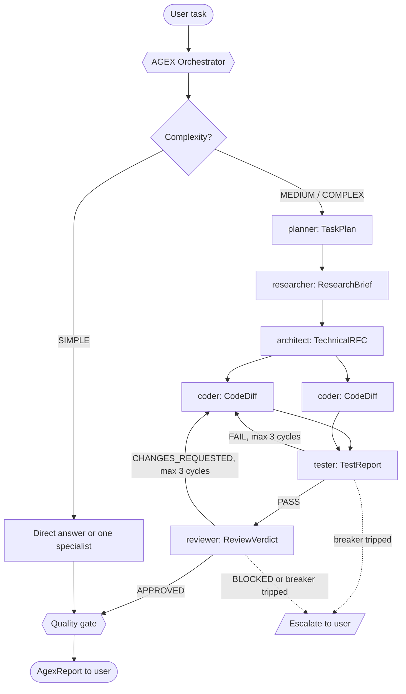

# AGEX Project Intelligence

This file orients Claude Code when it works inside the AGEX repository. It explains what AGEX is, how the pipeline fits together, and the rules for changing agents, commands, docs, and releases here.

## What AGEX Is

AGEX (Agent Executor) is an open-source multi-agent orchestration framework for Claude Code, released under the MIT license. It ships 12 subagents (an orchestrator and 11 specialists) and 8 slash commands as plain Markdown. A master orchestrator classifies each task, decomposes it, dispatches specialists that exchange typed handoff artifacts, runs coder-tester and coder-reviewer feedback loops behind circuit breakers, and synthesizes one verified AgexReport. There is no server, no runtime dependency, and no telemetry; the only executable code is the POSIX logging hook, the installers, and the repository validator.

- Version 1.0.0, released 2026-09-27. Plugin id `agex`, marketplace `agex-marketplace`.
- Repository: https://github.com/saksham-eng560/agex (issues and private security advisories on GitHub only; never add an email address anywhere in the repo).
- Requires Claude Code v2.1 or later (developed and tested against 2.1.283).

This repository dogfoods itself: `.claude/agents/` and `.claude/commands/` are project-level here, so `/agex` and every specialist work inside the repo, and `.claude/settings.json` turns on session logging to `.agex/session.log`.

## Repository Layout

| Path | Purpose |
|---|---|
| `.claude/agents/*.md` | The 12 agent definitions (frontmatter plus system prompt) |
| `.claude/commands/*.md` | The 8 slash commands |
| `.claude/settings.json` | Project hooks for working in this repo (uses `$CLAUDE_PROJECT_DIR`) |
| `.claude-plugin/plugin.json` | Plugin manifest: explicit `agents`, `commands`, and `hooks` paths |
| `.claude-plugin/marketplace.json` | Single-plugin marketplace with `source: "./"` |
| `hooks/agex-hooks.json` | Plugin hooks (uses `${CLAUDE_PLUGIN_ROOT}`) |
| `hooks/scripts/agex-log.sh` | POSIX sh logger writing `.agex/session.log`; always exits 0 |
| `scripts/validate.py` | Repository validator (Python 3.8+, standard library only), run by CI |
| `.github/workflows/ci.yml` | CI: validator, ShellCheck, `claude plugin validate --strict`, installer smoke tests (Ubuntu, macOS, Windows), hook logger tests |
| `install.sh`, `install.ps1` | Script installers for macOS/Linux and Windows; record installs in `~/.claude/.agex-manifest` and back up replaced files to `~/.claude/.agex-backup/<timestamp>/` |
| `docs/` | Architecture, agents, quickstart, customization, handoff protocol, examples, FAQ |
| `examples/*/task.md` | Worked example tasks |
| `templates/` | Starting points for user-defined agents and commands |

## Architecture



Complexity classes decide how much of the pipeline runs:

| Class | Criteria | Pipeline |
|---|---|---|
| SIMPLE | One concern, 1-2 files, no design decisions, obvious answer or change | Answer directly (read-only questions) or dispatch exactly one specialist; no planner, no ceremony |
| MEDIUM | 2-5 files, one component, clear approach | (planner optional) → coder → tester ⇄ coder → reviewer ⇄ coder |
| COMPLEX | Multiple components, new data model or API, unclear requirements, more than 5 files, or cross-cutting risk | planner → researcher → architect → coders in parallel per independent work unit → tester ⇄ coder → reviewer ⇄ coder → documenter if public API or docs change → quality gate |

Parallelism: independent agents and work units are dispatched in the same turn (several Agent tool calls in one message); dependent steps stay sequential; two coders never edit the same file concurrently.

Quality gate before a DONE report: latest TestReport PASS and latest ReviewVerdict APPROVED (either is not applicable only when the routed chain omits that agent, such as a SIMPLE single-specialist, plan-only, or documentation run, with the reason stated), no open CRITICAL or HIGH security findings, and every acceptance criterion from the RFC or TaskPlan checked.

## The 12 Agents

| Agent | Model | Produces | One-line description |
|---|---|---|---|
| orchestrator | opus | AgexReport | Master coordinator: classifies complexity, decomposes work, dispatches specialists, enforces circuit breakers, synthesizes the result; never edits files itself |
| researcher | sonnet | ResearchBrief | Read-only investigator of code paths, docs, and the web, reporting `file:line` evidence |
| architect | sonnet | TechnicalRFC | Read-only designer who decomposes features into atomic, independently testable work units; never writes implementation code |
| coder | sonnet | CodeDiff | Implements one work unit at a time following the RFC and project conventions, then runs type checks, linters, and tests |
| reviewer | sonnet | ReviewVerdict | Adversarial read-only reviewer hunting bugs, security holes, performance problems, and convention violations |
| tester | sonnet | TestReport | Writes and runs unit, integration, and end-to-end tests; only creates or edits test files |
| debugger | sonnet | DebugReport | Reproduces, isolates, and root-causes failures before a minimal targeted fix, then verifies it |
| documenter | haiku | DocUpdate | Writes and updates READMEs, API references, doc comments, guides, and changelog entries, preserving existing docs |
| devops | sonnet | DevOpsChange | Handles CI/CD, Dockerfiles, deployment config, and IaC with local verification and rollback plans; stops for human confirmation before remote or irreversible operations |
| refactor | sonnet | RefactorReport | Removes smells and debt through incremental, behavior-preserving steps with the test suite run before and after each |
| security | sonnet | SecurityAuditReport | Read-only auditor for leaked secrets, OWASP Top 10 issues, vulnerable dependencies, and unsafe configuration |
| planner | haiku | TaskPlan | Read-only planner that orders sub-tasks with dependencies, parallel groups, complexity, and an assigned agent; never executes |

Tool grants (least privilege) are exact and enforced by `scripts/validate.py`:

| Agent | tools | disallowedTools |
|---|---|---|
| orchestrator | Agent, Read, Grep, Glob, Bash | none |
| researcher | Read, Grep, Glob, WebSearch, WebFetch, Bash | Write, Edit |
| architect, planner | Read, Grep, Glob | none |
| reviewer, security | Read, Grep, Glob, Bash | Write, Edit |
| documenter | Read, Write, Edit, Grep, Glob | none |
| coder, tester, debugger, devops, refactor | Read, Write, Edit, Bash, Grep, Glob | none |

## Routing Rules

| Task type | Primary | Typical chain |
|---|---|---|
| Question / investigation | researcher | researcher → answer |
| Plan only | planner | planner |
| New feature | architect + coder | planner → researcher → architect → coder → tester → reviewer |
| Bug / failing test / stack trace | debugger | debugger → tester (regression test) → reviewer |
| Refactor / cleanup | refactor | refactor → reviewer |
| Security audit | security | security → (coder fixes if requested) → reviewer → security re-check |
| Code review | reviewer | reviewer (+ security when auth, input handling, crypto, or secrets are touched) |
| Tests | tester | tester → (coder if tests expose bugs) |
| Documentation | documenter | documenter |
| CI/CD, Docker, deploy | devops | devops → reviewer; human confirmation before remote ops |

Naming rule for dispatch: use the scoped name `agex:<name>` if the Agent tool lists it (plugin install); otherwise use the bare name `<name>`. Scoped names cannot be shadowed by same-named user agents; bare names follow Claude Code precedence (project `.claude/agents` over user `~/.claude/agents` over plugin).

## Handoff Artifacts

Every artifact starts with a machine-detectable marker line and a title line, followed by its sections as `###` headings in the order listed:

```markdown
<!-- agex:artifact type=<Type> version=1 -->
## <Type>: <short title>
**Producer:** <agent> · **Status:** <enum> · **Confidence:** HIGH | MEDIUM | LOW
```

Confidence is optional for TestReport and CodeDiff.

### TaskPlan (planner)

Status: READY | NEEDS_INPUT

1. Goal
2. Assumptions
3. Steps: table `# | Step | Agent | Depends On | Parallel Group | Complexity (S/M/L) | Done When`
4. Execution Waves: for example "Wave 1: steps 1, 2 (parallel)"
5. Risks & Mitigations
6. Open Questions

### ResearchBrief (researcher)

Status: COMPLETE | PARTIAL | BLOCKED

1. Problem Summary
2. Affected Files: `path:line — why it matters`
3. External Documentation: one Markdown link per source (title and URL) followed by `— key fact`
4. Dependencies
5. Constraints & Risks
6. Open Questions

### TechnicalRFC (architect)

Status: PROPOSED | NEEDS_INPUT

1. Context & Goals
2. Non-Goals
3. Component Architecture
4. Data Flow: a mermaid diagram
5. Interface & Type Definitions
6. Implementation Sequence: work units `WU-1`, `WU-2`, ... each with Files, Change, Depends On, Acceptance Criteria, and Parallel-safe (yes/no)
7. Test Requirements
8. Alternatives Considered & Risks

### TestReport (tester)

Status: PASS | FAIL | ERROR

1. Test Suites Executed: the exact commands run
2. Pass/Fail Summary: table `Suite | Passed | Failed | Skipped`
3. Tests Added or Updated
4. Edge Cases Covered
5. Failure Traces: per failure, the test id, expected, actual, trace excerpt, and suspected location `path:line`
6. Coverage: the measured value, or "not measured"
7. Recommendation for Coder

### ReviewVerdict (reviewer)

Status: APPROVED | CHANGES_REQUESTED | BLOCKED

1. Summary
2. Issues: table `ID | Severity | Category | Location | Problem | Remediation`; Severity is CRITICAL | HIGH | MEDIUM | LOW; Category is one of logic, security, performance, concurrency, error-handling, edge-case, style, tests
3. Checks Performed: a checklist
4. What Is Good: at most 3 bullets

Decision rule: any CRITICAL → BLOCKED; otherwise any HIGH or MEDIUM → CHANGES_REQUESTED; otherwise APPROVED, with LOW items listed as non-blocking.

### Other artifacts

CodeDiff (coder), DebugReport (debugger), SecurityAuditReport (security), RefactorReport (refactor), DocUpdate (documenter), DevOpsChange (devops), and AgexReport (orchestrator) are specified section by section in [docs/HANDOFF-PROTOCOL.md](docs/HANDOFF-PROTOCOL.md).

## Circuit Breakers

These rules are non-negotiable and must read the same in every file that states them:

- Coder ⇄ Tester loop: at most 3 cycles per work unit. A cycle is one coder fix plus one tester re-run; a unit's first test run and first review are not cycles. After the 3rd failing TestReport inside the loop (the re-run that closes cycle 3), stop and escalate to the user.
- Coder ⇄ Reviewer loop: at most 3 cycles per work unit. A BLOCKED verdict stops the loop immediately; route once to the architect for a redesign, or escalate.
- Counters are independent per loop and per work unit.
- No-progress rule: two consecutive cycles failing with the same failure signature escalate early.
- Sub-agent failure (error, empty, or malformed artifact): retry once with simplified, narrower instructions; a second failure escalates.
- Dispatch budget: soft cap of 15 sub-agent dispatches per run; ask the user before exceeding it.

Escalations use this exact block:

```text
### ESCALATION: <loop or agent> circuit breaker tripped
- What was attempted: <cycles, agents>
- Evidence: <latest artifact excerpt>
- Options: 1) ... 2) ... 3) ...
- Recommended: <option>
```

Session log: when `.agex/` exists in a project, the orchestrator appends one line per event, for example `echo "[$(date -u +%Y-%m-%dT%H:%M:%SZ)] DISPATCH agent=coder unit=WU-2" >> .agex/session.log`. Event names: DISPATCH, ARTIFACT (type=... status=...), CYCLE (loop=coder-tester n=2/3), ESCALATION, RUN_COMPLETE. Hooks write SESSION_START and FILE_MODIFIED; `AGEX_DISABLE_LOG=1` disables hook logging.

## Command Quick Reference

| Command (script install) | Plugin install | Agent(s) | Artifact |
|---|---|---|---|
| `/agex <task>` | `/agex:agex` | main conversation acts as orchestrator | AgexReport |
| `/agex-plan <task>` | `/agex:agex-plan` | planner | TaskPlan |
| `/agex-status` | `/agex:agex-status` | none (reports agents, session log, project context) | status summary |
| `/agex-research <topic>` | `/agex:agex-research` | researcher | ResearchBrief |
| `/agex-review [path or git ref]` | `/agex:agex-review` | reviewer (+ security when sensitive code is touched) | ReviewVerdict |
| `/agex-test [target]` | `/agex:agex-test` | tester | TestReport |
| `/agex-secure [scope]` | `/agex:agex-secure` | security | SecurityAuditReport |
| `/agex-docs <docs task>` | `/agex:agex-docs` | documenter | DocUpdate |

Run a whole session as the orchestrator with `claude --agent orchestrator` (plugin: `claude --agent agex:orchestrator`). Delegating a whole task to the `orchestrator` subagent also works, because Claude Code supports nested subagents up to 3 layers below the main conversation by default (`CLAUDE_CODE_MAX_SUBAGENT_SPAWN_DEPTH` changes the limit).

## Modular Docs

The architecture deep dive and the full agent catalog are imported below so they load with this file:

@docs/ARCHITECTURE.md

@docs/AGENTS.md

Read the rest on demand: [docs/HANDOFF-PROTOCOL.md](docs/HANDOFF-PROTOCOL.md) (every artifact schema), [docs/CUSTOMIZATION.md](docs/CUSTOMIZATION.md), [docs/QUICKSTART.md](docs/QUICKSTART.md), [docs/EXAMPLES.md](docs/EXAMPLES.md), and [docs/FAQ.md](docs/FAQ.md). Contributor workflow and the release procedure are in [CONTRIBUTING.md](CONTRIBUTING.md).

## Working on This Repository

### Agent file conventions

- Frontmatter fields in this order: `name`, `description`, `tools`, `disallowedTools` (only for researcher, reviewer, security), `model`, `color`.
- `name` is kebab-case and equals the filename stem. `description` is one line, double-quoted, starts with the role, and says when to use the agent. `tools` and `disallowedTools` are comma-separated strings (`tools: Read, Grep, Glob`). `model` is an alias (`opus`, `sonnet`, `haiku`). `color` is one of red, blue, green, yellow, purple, orange, pink, cyan.
- The body after the frontmatter is 300-800 words; the orchestrator's body is 600-800 words.
- Required headings, in order: `# <Role Title> — AGEX <Agent Name>` with a 2-4 sentence second-person persona and goal; `## Your Place in the AGEX Pipeline`; `## Operating Procedure` (numbered steps); `## Hard Constraints` (at least 4 bullets starting with **NEVER**); `## Output Format` (the artifact template in a markdown fence, matching the canonical schema exactly). `## Quality Bar` and `## Escalation` are optional.
- Agents must be self-contained: users install AGEX into other projects where `docs/` does not exist, so an agent must never tell itself to read AGEX documentation files.
- Agents never invent results: every claim about tests or builds comes from a command that actually ran.
- Read-only agents (researcher, architect, reviewer, security, planner) state that any Bash they have is for read-only inspection only: no redirects to files, no installs, no git state changes.
- Plugin subagents ignore `hooks`, `mcpServers`, and `permissionMode` frontmatter, so AGEX agents do not use those fields.
- No emojis in agent or command files.

### Command injection safety

A `` !`command` `` injection runs before the model sees the prompt, and a non-zero exit or a command not covered by `allowed-tools` aborts the whole slash command. Every injection must therefore:

- Be strictly read-only and end in a guaranteed-success fallback: `... 2>/dev/null || echo "(fallback message)"`, or a pipeline ending in `head`, which exits 0.
- Use only `git status`, `git ls-files`, `git diff`, `git log`, `grep`, `head`, `tail`, `ls`, `echo`, and `wc`, each listed in `allowed-tools` as a space-separated pattern such as `Bash(git status *) Bash(head *)`, listing only the programs the command actually uses.
- Never use `find`, `cat`, `sh -c`, `xargs`, redirects to files, or anything that prints the contents of secret files. List project files with `git ls-files --cached --others --exclude-standard` and read files with `head -N`.
- Never use `git diff HEAD~1`, which fails in a repository with one commit. For the last commit use `git log -1 --stat -p 2>/dev/null | head -200 || echo "(no commits yet)"`.
- Start at the beginning of a line or after whitespace.

Command frontmatter holds `description` (quoted, one line), `argument-hint` for commands that take arguments, and `allowed-tools`; there is no `model` field. `$ARGUMENTS` is the argument placeholder, and commands that need a task must handle an empty argument by asking the user what to do and stopping. Each command body names the AGEX agent(s) to dispatch, applying the naming rule above, and the artifact to present. A focused command whose specialist is listed under neither name (or that runs without an Agent tool) says so and performs the task inline under that specialist's procedure and constraints, producing the same artifact with the Producer `<name> (inline fallback)`; it never substitutes a different agent and never delegates through other sessions or background, remote, or scheduled tasks. `/agex` does not fall back: it names the missing agent and stops.

### Adding or renaming an agent or command

Keep these in sync in the same change; `scripts/validate.py` checks the ones it can:

1. The file itself under `.claude/agents/` or `.claude/commands/`.
2. The `agents` or `commands` array in `.claude-plugin/plugin.json`.
3. The Agent Catalog or Command Reference table in `README.md`, plus the Agents or Commands badge count.
4. The agent specification in `docs/AGENTS.md`, and the handoff schema in `docs/HANDOFF-PROTOCOL.md` if a new artifact type is introduced.
5. The agent tables, routing rules, and command reference in this file.
6. The routing table in `.claude/agents/orchestrator.md`, the routing in `.claude/commands/agex.md`, and the agent list in `.claude/commands/agex-status.md`.
7. The counts in the plugin description in `.claude-plugin/marketplace.json`.
8. The expected agent roster or command list in `scripts/validate.py`.
9. An entry under `## [Unreleased]` in `CHANGELOG.md`.

The two hook configurations, `.claude/settings.json` (this repo) and `hooks/agex-hooks.json` (plugin), must register the same events and matchers. `hooks/scripts/agex-log.sh` stays POSIX sh, logs paths and event names only (never file contents), and always exits 0.

### Documentation style

- GitHub-flavored Markdown with exactly one H1 per document. Relative links between repository files, and every relative link must resolve to a file that exists.
- No placeholder or stub text of any kind (to-do markers, "to be decided" notes, filler text, invented usernames or email addresses). Files in `templates/` may use `<angle-bracket>` fill-in fields; that is their purpose.
- Be honest: no benchmarks, star counts, adoption claims, or testimonials. State known limitations where relevant: read-only is enforced at the tool level for Write and Edit only; plugin subagents ignore `hooks`, `mcpServers`, and `permissionMode`; script installs share the global agent namespace and can collide with same-named user agents; the orchestrator runs on Opus and the planner and documenter on Haiku; hooks are active only in plugin installs and inside this repository.
- Emojis only in `README.md` headings and value propositions and in the `CHANGELOG.md` title line; never in agents, commands, this file, or the body text of `docs/`.
- The architecture diagram in `README.md`, this file, and `docs/ARCHITECTURE.md` is the same canonical mermaid block; change all three together.

### Before committing

Run both validators and fix every error:

```bash
python3 scripts/validate.py
claude plugin validate --strict .
```

CI runs both on every pull request and push to `main`, together with ShellCheck, installer smoke tests on Ubuntu, macOS, and Windows, and hook logger tests. Never commit `.agex/` contents; the directory ignores itself.

### Version bump checklist

AGEX follows Semantic Versioning. Breaking changes to artifact schemas, or renamed or removed agents, commands, or installer flags, make a major release; new agents, commands, or backward-compatible features make a minor release; bug fixes, prompt improvements that keep artifact schemas unchanged, and documentation fixes make a patch release. The full release procedure is in [CONTRIBUTING.md](CONTRIBUTING.md).

1. `.claude-plugin/plugin.json`: `version`.
2. `.claude-plugin/marketplace.json`: `metadata.version` and the plugin entry's `version`.
3. `CHANGELOG.md`: move the `## [Unreleased]` entries into `## [X.Y.Z] - YYYY-MM-DD`, and update the `[Unreleased]` and `[X.Y.Z]` link references at the bottom.
4. `README.md`: the Version badge (`version-vX.Y.Z`).
5. Run both validators.
6. A maintainer creates the `vX.Y.Z` tag and the GitHub release after merge. Agents never push, tag, or publish.
