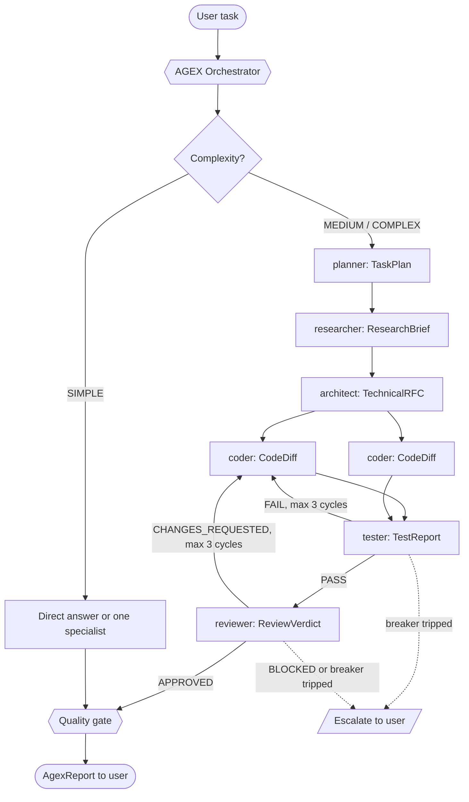

<div align="center">

```text
    ___   ____________ _  __
   /   | / ____/ ____/| |/ /
  / /| |/ / __/ __/   |   /
 / ___ / /_/ / /___  /   |
/_/  |_\____/_____/ /_/|_|

The Master Agent Orchestrator for Claude Code
```

# AGEX · Agent Executor

**Deploy intelligent sub-agents that work together to accomplish any coding task.**

[](LICENSE)
[](https://github.com/saksham-eng560/agex/releases)
[](#requirements)
[](#agent-catalog)
[](#command-reference)

[Why AGEX](#why-agex) · [Install](#quick-install) · [Quick Start](#quick-start) · [Agents](#agent-catalog) · [Commands](#command-reference) · [Architecture](#architecture) · [Docs](#documentation) · [FAQ](#faq)

</div>

---

AGEX turns Claude Code into a coordinated engineering team. One command, `/agex <task>`, puts a master orchestrator in charge: it sizes up the request, decomposes it, dispatches the specialists it needs from a team of eleven (planner, researcher, architect, coder, tester, reviewer, and more), passes typed handoff artifacts between them, runs coder-tester and coder-reviewer feedback loops behind hard circuit breakers, and hands you a single verified report.

It is plain Markdown on top of Claude Code's native subagents and slash commands: no server, no daemon, no API keys of its own, no telemetry.

## Why AGEX?

### 🧠 Intelligent Task Decomposition

Every request is classified as **SIMPLE**, **MEDIUM**, or **COMPLEX** before a single sub-agent is dispatched. A one-line fix gets a direct answer or exactly one specialist, with no planning ceremony. A new subsystem goes through planner, researcher, and architect first, producing a TechnicalRFC that splits the work into atomic, independently testable work units (`WU-1`, `WU-2`, ...), each with its own files, acceptance criteria, and a parallel-safe flag.

### 🔄 Autonomous Feedback Loops with Circuit Breakers

The coder and tester iterate on failing tests, and the coder and reviewer iterate on requested changes, without you in the loop. Each loop is capped at **3 cycles per work unit**, two consecutive cycles with the same failure signature trip the breaker early, and a `BLOCKED` review halts the loop at once for a single redesign or an escalation. When a breaker trips you get a structured escalation with the evidence, ranked options, and a recommendation instead of an agent burning tokens in circles; a soft cap of 15 dispatches per run means AGEX asks before it spends more.

### 🔒 Principle of Least Privilege

Each agent gets only the tools its job needs. The researcher, architect, reviewer, security auditor, and planner have no Write or Edit tools; the tester only creates or edits test files; the documenter only touches documentation; and the devops agent stops for explicit human confirmation before any push, deploy, tag, or other remote or irreversible operation. Honest caveat: read-only is enforced at the tool level for Write and Edit, while agents that keep Bash for inspection are bound by their instructions, not a sandbox (see [SECURITY.md](SECURITY.md)).

### ⚡ Parallel Agent Execution

Independent work units from the RFC are dispatched to several coder agents in the same turn, while dependent steps stay strictly sequential. Every sub-agent runs in its own context window and returns one compact, typed artifact, so the orchestrator's context stays focused on decisions instead of raw exploration output. Two coders are never allowed to edit the same file at the same time.

## Quick Install

```bash
# One-command install (macOS/Linux)
curl -fsSL https://raw.githubusercontent.com/saksham-eng560/agex/main/install.sh | bash

# Or clone manually
git clone https://github.com/saksham-eng560/agex.git ~/.agex
cd ~/.agex && ./install.sh

# Or install as a Claude Code plugin
claude plugin marketplace add saksham-eng560/agex
claude plugin install agex@agex-marketplace
```

**Windows (PowerShell):**

```powershell
# One-command install
irm https://raw.githubusercontent.com/saksham-eng560/agex/main/install.ps1 | iex

# Or clone manually
git clone https://github.com/saksham-eng560/agex.git "$HOME\.agex"
cd "$HOME\.agex"; .\install.ps1
```

The install scripts clone AGEX to `~/.agex` (or update an existing checkout with `git pull --ff-only`; run from inside a checkout, they use that one) and link its agents and commands into `~/.claude/agents` and `~/.claude/commands`, so they are available in every project. Re-run the script to update.

- **Nothing of yours is overwritten.** A file with the same name as an AGEX file is skipped with a warning; `--force` first moves it to `~/.claude/.agex-backup/<timestamp>/`.
- **Clean removal.** The installed links are recorded in `~/.claude/.agex-manifest`. `--uninstall` (PowerShell: `-Uninstall`) removes only what AGEX created, restores backed-up files, and leaves the checkout in place.
- **Windows.** Without Developer Mode or an elevated shell, `install.ps1` copies the files instead of linking them; re-run it after each update to refresh the copies.

| `install.sh` | `install.ps1` | Effect |
|---|---|---|
| `--uninstall` | `-Uninstall` | Remove the AGEX agents and commands from your Claude Code config and restore backed-up files |
| `--force` | `-Force` | Back up existing files that have the same names as AGEX files, then install AGEX's |
| `--dir <path>` | `-Dir <path>` | Use the checkout at `<path>` instead of `~/.agex` (cloned there if it does not exist) |
| `--no-update` | `-NoUpdate` | Skip `git pull` on an existing checkout |
| `--help` | `-Help` | Show usage |

Environment overrides for both scripts: `AGEX_HOME` (default `~/.agex`), `AGEX_REPO` (default `https://github.com/saksham-eng560/agex.git`, used only when cloning), `CLAUDE_HOME` (default `~/.claude`), and `NO_COLOR`. Because `irm ... | iex` cannot pass parameters, `install.ps1` also reads `AGEX_UNINSTALL=1`, `AGEX_FORCE=1`, and `AGEX_NO_UPDATE=1`.

> [!TIP]
> **Plugin or script?** The plugin install namespaces everything (`agex:orchestrator`, `/agex:agex`), so agents you already have can never shadow AGEX's, and it enables AGEX session logging automatically. The script install gives you short names (`orchestrator`, `/agex`) and installs agents and commands only. Pick one method: with both, every agent and command shows up twice.

## Quick Start

**1. Install AGEX** with any method from [Quick Install](#quick-install).

**2. Open your project in Claude Code:**

```bash
cd ~/code/my-api
claude
```

**3. Hand AGEX a task:**

```text
/agex Add rate limiting to POST /api/login: max 5 attempts per IP per 15 minutes, respond 429 with a Retry-After header
```

With the plugin install, type `/agex` and pick `/agex:agex` from the autocomplete. The orchestrator classifies the task, dispatches the right specialists, loops until tests pass and the review is approved (or a breaker trips), then reports back. An illustrative, abridged final report looks like this:

```markdown
<!-- agex:artifact type=AgexReport version=1 -->
## AgexReport: Rate limiting for POST /api/login
**Producer:** orchestrator · **Status:** DONE · **Confidence:** HIGH

### Task
Per-IP rate limiting on POST /api/login (5 attempts / 15 min, 429 + Retry-After). Complexity: MEDIUM.

### Outcome
Login attempts are limited per client IP; the 6th attempt within the window returns 429 with Retry-After.

### Agents Deployed
| # | Agent    | Artifact      | Status      | Cycle            |
|---|----------|---------------|-------------|------------------|
| 1 | coder    | CodeDiff      | IMPLEMENTED | n/a              |
| 2 | tester   | TestReport    | FAIL        | n/a              |
| 3 | coder    | CodeDiff      | IMPLEMENTED | coder-tester 1/3 |
| 4 | tester   | TestReport    | PASS        | coder-tester 1/3 |
| 5 | reviewer | ReviewVerdict | APPROVED    | n/a              |

### Changes
- src/middleware/rateLimit.ts (added)
- src/routes/auth.ts (modified)
- tests/rateLimit.test.ts (added)

### Verification Evidence
- `npm test -- rateLimit`: PASS (tester, coder-tester cycle 1)
- `npx tsc --noEmit`: no errors (coder)

### Open Issues & Escalations
- LOW (non-blocking): limiter state is in-memory; use a shared store before running multiple instances.

### Next Steps
- Review the diff and commit when satisfied.
```

> [!NOTE]
> `/agex` makes your main conversation act as the orchestrator, so you see every dispatch and escalations come straight to you. You can also run a whole session as the orchestrator with `claude --agent orchestrator` (plugin: `claude --agent agex:orchestrator`), or call a single specialist directly with the focused commands below.

## Agent Catalog

| Agent | Role | Model | Tools | Read-only |
|---|---|---|---|---|
| `orchestrator` | Master coordinator: classifies complexity, decomposes work, dispatches specialists, enforces circuit breakers, synthesizes the AgexReport | opus | Agent, Read, Grep, Glob, Bash | No edits (delegates) |
| `researcher` | Investigates the codebase, docs, and web before changes; ResearchBrief with `file:line` evidence | sonnet | Read, Grep, Glob, WebSearch, WebFetch, Bash | Yes (Write, Edit disallowed) |
| `architect` | Designs features, data models, and API contracts; TechnicalRFC with atomic work units | sonnet | Read, Grep, Glob | Yes |
| `coder` | Implements one work unit at a time, then runs type checks, linters, and tests; CodeDiff | sonnet | Read, Write, Edit, Bash, Grep, Glob | No |
| `reviewer` | Adversarial review for bugs, security, performance, and conventions; ReviewVerdict | sonnet | Read, Grep, Glob, Bash | Yes (Write, Edit disallowed) |
| `tester` | Writes and runs unit, integration, and end-to-end tests; TestReport with failure traces | sonnet | Read, Write, Edit, Bash, Grep, Glob | Test files only |
| `debugger` | Reproduces, isolates, and root-causes failures before a minimal fix; DebugReport | sonnet | Read, Write, Edit, Bash, Grep, Glob | No |
| `documenter` | READMEs, API references, doc comments, guides, and changelogs; DocUpdate | haiku | Read, Write, Edit, Grep, Glob | Docs only |
| `devops` | CI/CD pipelines, Dockerfiles, deployment config, and IaC with rollback plans; DevOpsChange | sonnet | Read, Write, Edit, Bash, Grep, Glob | No (remote ops need human OK) |
| `refactor` | Behavior-preserving refactoring with the test suite run before and after every step; RefactorReport | sonnet | Read, Write, Edit, Bash, Grep, Glob | No |
| `security` | Audits for leaked secrets, OWASP Top 10 issues, vulnerable dependencies, and unsafe config; SecurityAuditReport | sonnet | Read, Grep, Glob, Bash | Yes (Write, Edit disallowed) |
| `planner` | Breaks a request into ordered steps with dependencies, parallel groups, and an agent per step; TaskPlan | haiku | Read, Grep, Glob | Yes |

Plugin installs expose these as `agex:<name>` (for example `agex:planner`). The orchestrator runs on Opus, the planner and documenter on Haiku, and everything else on Sonnet; change the `model:` line in any agent file to trade cost for capability. Full specifications: [docs/AGENTS.md](docs/AGENTS.md).

## Command Reference

| Command | Description |
|---|---|
| `/agex <task>` | Deploy the full orchestrator on any task: assess complexity, dispatch specialists, enforce circuit breakers, deliver an AgexReport |
| `/agex-plan <task>` | Create an execution plan without running it: a TaskPlan with steps, agents, dependencies, parallel waves, and risks |
| `/agex-status` | Show the available AGEX agents, recent session activity from `.agex/session.log`, and a project context summary |
| `/agex-research <topic>` | Deploy the researcher for a read-only investigation; returns a ResearchBrief |
| `/agex-review [path or git ref]` | Deploy the reviewer on a path or ref you name, or else on your staged, unstaged, or last-committed changes; adds the security auditor when auth, input handling, crypto, or secrets are touched; returns a ReviewVerdict |
| `/agex-test [target]` | Deploy the tester to write and run tests for a module or feature; returns a TestReport |
| `/agex-secure [scope]` | Deploy the security auditor on source files, dependency manifests, and configuration; returns a SecurityAuditReport |
| `/agex-docs <docs task>` | Deploy the documenter to write or update documentation; returns a DocUpdate |

With the plugin install, commands are namespaced as `/agex:<command>`, for example `/agex:agex` and `/agex:agex-review`. Commands gather project context with strictly read-only shell snippets that always fall back gracefully, so they work in brand-new and non-git directories too. If a focused command's specialist is not available in the session, the command says so and does the job inline under that specialist's rules, returning the same artifact.

## Architecture



The orchestrator first sizes the task. SIMPLE requests are answered directly or handed to exactly one specialist; MEDIUM tasks go straight to the coder with tester and reviewer loops (planning optional); COMPLEX tasks run the full pipeline shown above, where the planner orders the work, the researcher gathers `file:line` evidence, and the architect turns it into an RFC whose independent work units are implemented by coders in parallel. Every hop is a typed artifact with a machine-detectable status, which is what lets the orchestrator route mechanically: a `FAIL` or `CHANGES_REQUESTED` sends the work unit back to the coder, a `BLOCKED` verdict halts the loop and goes once to the architect for a redesign or straight to you, and nothing reaches you as DONE until the quality gate sees a passing TestReport, an approved ReviewVerdict, no open CRITICAL or HIGH security findings, and every acceptance criterion checked. Deep dive: [docs/ARCHITECTURE.md](docs/ARCHITECTURE.md) and [docs/HANDOFF-PROTOCOL.md](docs/HANDOFF-PROTOCOL.md).

Runs leave an audit trail in `.agex/session.log`, which `/agex-status` summarizes. In plugin installs the AGEX hooks create the log and record session starts and file edits (paths only, never contents); whenever `.agex/` exists, the orchestrator appends its own events:

```text
[2026-09-27T10:15:02Z] SESSION_START source=startup
[2026-09-27T10:16:40Z] DISPATCH agent=coder unit=WU-1
[2026-09-27T10:17:55Z] FILE_MODIFIED tool=Write path=src/middleware/rateLimit.ts
[2026-09-27T10:18:30Z] ARTIFACT type=CodeDiff status=IMPLEMENTED
[2026-09-27T10:18:31Z] DISPATCH agent=tester unit=WU-1
[2026-09-27T10:19:12Z] ARTIFACT type=TestReport status=FAIL
[2026-09-27T10:19:13Z] CYCLE loop=coder-tester n=1/3
[2026-09-27T10:24:31Z] RUN_COMPLETE status=DONE
```

## Handoff Artifacts

Agents never pass free-form chatter to each other. Each one returns a single Markdown artifact that starts with a marker line and a status header:

```markdown
<!-- agex:artifact type=ReviewVerdict version=1 -->
## ReviewVerdict: Rate limiter middleware
**Producer:** reviewer · **Status:** CHANGES_REQUESTED · **Confidence:** HIGH
```

| Artifact | Producer | Status values |
|---|---|---|
| TaskPlan | planner | READY, NEEDS_INPUT |
| ResearchBrief | researcher | COMPLETE, PARTIAL, BLOCKED |
| TechnicalRFC | architect | PROPOSED, NEEDS_INPUT |
| CodeDiff | coder | IMPLEMENTED, PARTIAL, BLOCKED |
| TestReport | tester | PASS, FAIL, ERROR |
| ReviewVerdict | reviewer | APPROVED, CHANGES_REQUESTED, BLOCKED |
| DebugReport | debugger | FIXED, NOT_REPRODUCED, NEEDS_ESCALATION |
| SecurityAuditReport | security | PASS, FINDINGS, CRITICAL_FINDINGS |
| RefactorReport | refactor | COMPLETE, PARTIAL, ABORTED |
| DocUpdate | documenter | COMPLETE, PARTIAL |
| DevOpsChange | devops | READY_FOR_CONFIRMATION, APPLIED_LOCALLY, BLOCKED |
| AgexReport | orchestrator | DONE, PARTIAL, ESCALATED |

Verdicts follow fixed rules. For example, any CRITICAL issue makes a review `BLOCKED`, any HIGH or MEDIUM issue makes it `CHANGES_REQUESTED`, and LOW issues are listed as non-blocking. Secrets found by the security auditor are never reproduced beyond their first four characters. The section-by-section schemas are in [docs/HANDOFF-PROTOCOL.md](docs/HANDOFF-PROTOCOL.md).

## Customization

- **Add your own agent.** Copy [templates/custom-agent.md](templates/custom-agent.md) to `.claude/agents/<name>.md` in your project (or `~/.claude/agents/` for every project), give it a precise one-line `description` and the smallest tool set that works, and have it return a typed artifact so the orchestrator can route on its status.
- **Add your own command.** Copy [templates/custom-command.md](templates/custom-command.md) to `.claude/commands/<name>.md`. Keep every `!` context injection read-only and ending in a guaranteed-success fallback, because a failing injection aborts the whole command.
- **Tune models and behavior.** Change `model:` in any agent's frontmatter. With a script install, a project-level `.claude/agents/<name>.md` overrides the AGEX agent of the same name for that project; plugin installs dispatch scoped `agex:<name>` agents, which same-named local agents cannot shadow.

[docs/CUSTOMIZATION.md](docs/CUSTOMIZATION.md) covers wiring a custom agent into the orchestrator's routing, adding session-logging hooks to a script install, and disabling logging with `AGEX_DISABLE_LOG=1`.

## Documentation

| Guide | What you will find |
|---|---|
| [Quickstart](docs/QUICKSTART.md) | From zero to your first `/agex` run in five minutes |
| [Architecture](docs/ARCHITECTURE.md) | Complexity classification, routing, parallelism, circuit breakers, and the quality gate |
| [Agents](docs/AGENTS.md) | Full specification of all 12 agents: tools, models, inputs, outputs, and constraints |
| [Handoff Protocol](docs/HANDOFF-PROTOCOL.md) | Every artifact schema, status enum, and decision rule |
| [Customization](docs/CUSTOMIZATION.md) | Custom agents and commands, model changes, hooks, and overrides |
| [Examples](docs/EXAMPLES.md) | Real-world runs, from a REST API build to a security audit |
| [FAQ](docs/FAQ.md) | Cost, safety, limitations, and troubleshooting |

Ready-to-run example tasks live in `examples/`: [web app build](examples/web-app-build/task.md), [bug fix](examples/bug-fix/task.md), [code review](examples/code-review/task.md), [full project](examples/full-project/task.md), and [security audit](examples/security-audit/task.md).

## Requirements

- **Claude Code v2.1 or later.** AGEX is developed and tested against 2.1.283.
- **Model access** for Opus, Sonnet, and Haiku, or edit the `model:` lines to match what your plan offers.
- **For the install scripts:** `git`, plus `bash` (3.2 or later) and `curl` on macOS/Linux, or Windows PowerShell 5.1 or PowerShell 7 on Windows. The plugin install needs only Claude Code.
- **Nested sub-agents** are supported by Claude Code by default up to 3 layers below the main conversation, which covers delegating a whole task to the `orchestrator` subagent. The `CLAUDE_CODE_MAX_SUBAGENT_SPAWN_DEPTH` environment variable changes the limit.
- **For contributors:** Python 3.8+ to run the repository validator (standard library only).

## FAQ

**Does AGEX send my code anywhere?** No. AGEX is a set of Markdown prompts and a local shell logger with no telemetry and no network calls of its own; the only outbound traffic is what Claude Code already does, including the web searches and fetches the researcher makes through Claude Code's built-in tools. The session log stays in your project's `.agex/` directory, which ignores itself in git.

**Does it cost more than a normal session?** A multi-agent run uses more tokens than a single conversation, and the orchestrator runs on Opus. SIMPLE tasks skip the pipeline entirely, loops are capped, and AGEX asks before exceeding 15 dispatches in one run.

**Are the read-only agents sandboxed?** Not fully. Write and Edit are removed at the tool level, but agents that keep Bash for inspection are restrained by their instructions, not by an operating-system sandbox. Review permission prompts as usual.

More answers, including known limitations and troubleshooting, in [docs/FAQ.md](docs/FAQ.md).

## Contributing

Contributions are welcome: new agents, sharper prompts, better docs, and bug reports. Start with [CONTRIBUTING.md](CONTRIBUTING.md), and before opening a pull request run:

```bash
python3 scripts/validate.py
claude plugin validate --strict .
```

CI runs both on every pull request and push to `main`, along with ShellCheck, installer smoke tests on Ubuntu, macOS, and Windows, and tests of the logging hook. Please follow the [Code of Conduct](CODE_OF_CONDUCT.md), and report bugs or propose features through [GitHub Issues](https://github.com/saksham-eng560/agex/issues).

## Security

AGEX agents can run shell commands and edit files in your project, so please read [SECURITY.md](SECURITY.md) for the trust model and known limitations. Report vulnerabilities privately through [GitHub private vulnerability reporting](https://github.com/saksham-eng560/agex/security/advisories/new), never in a public issue.

## License

AGEX is released under the [MIT License](LICENSE). Copyright (c) 2026 AGEX Contributors.

---

<div align="center">

### ⭐ If AGEX saves you time, star the repo

A star helps other Claude Code users discover the project.

[Star AGEX on GitHub](https://github.com/saksham-eng560/agex) · [Report a bug](https://github.com/saksham-eng560/agex/issues) · [Read the docs](docs/QUICKSTART.md)

</div>
