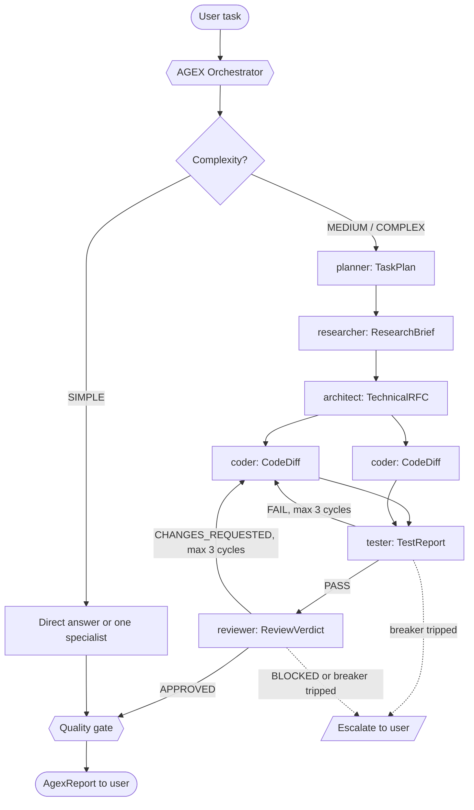
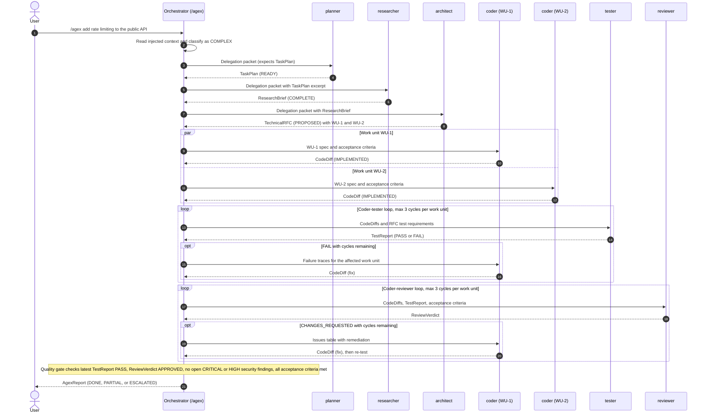
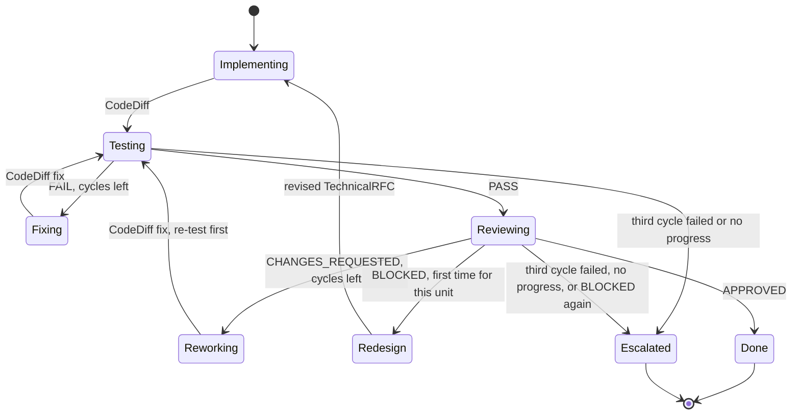

# AGEX Architecture

AGEX (Agent Executor) is a multi-agent orchestration layer for Claude Code built entirely from native Claude Code building blocks: subagent definitions, slash commands, hooks, and a plugin manifest. There is no server, daemon, SDK, or background process. This document explains how those pieces fit together, how a run flows from a request to a verified result, and why the system is shaped the way it is.

Companion references:

- [Agents](AGENTS.md) catalogs all twelve agents, their tools, and when to use each one.
- [Handoff Protocol](HANDOFF-PROTOCOL.md) is the normative specification of the artifacts agents exchange.
- [Customization](CUSTOMIZATION.md) covers changing models and tools, adding your own agents, and enabling hooks.
- [Quickstart](QUICKSTART.md), [Examples](EXAMPLES.md), and the [FAQ](FAQ.md) cover day-to-day use.

## Contents

- [Design Goals](#design-goals)
- [Hub-and-Spoke Topology](#hub-and-spoke-topology)
- [Components](#components)
- [Lifecycle of a Run](#lifecycle-of-a-run)
- [Complexity Tiers and Routing](#complexity-tiers-and-routing)
- [Nesting Model](#nesting-model)
- [Install Modes, Naming, and Scoping](#install-modes-naming-and-scoping)
- [Least-Privilege Matrix](#least-privilege-matrix)
- [Feedback Loops and Circuit Breakers](#feedback-loops-and-circuit-breakers)
- [Quality Gate](#quality-gate)
- [Session Logging](#session-logging)
- [Design Decisions and Trade-offs](#design-decisions-and-trade-offs)
- [Known Limitations](#known-limitations)

## Design Goals

1. **Specialists over a generalist.** Each agent does one job, with a system prompt, toolset, and model chosen for that job. A reviewer that cannot edit files reviews differently from one that is tempted to "just fix it".
2. **Typed, inspectable handoffs.** Agents exchange fixed-schema Markdown artifacts rather than free-form chat. Every artifact declares its producer, status, and confidence, and every claim about tests or builds must come from a command that was actually run.
3. **Bounded autonomy.** Feedback loops run without supervision, but only within hard limits. When a limit trips, AGEX stops and hands the decision to a human, with the evidence and a set of options.
4. **Least privilege.** Each agent receives only the tools its job requires. Five agents cannot modify files at all, and only the orchestrator can spawn other agents.
5. **Parallelism where it is safe.** Independent work units are dispatched concurrently, dependent steps stay sequential, and two coders never edit the same file at the same time.
6. **Proportional ceremony.** A one-line fix should not trigger a seven-agent pipeline. Complexity classification decides how much process a task receives.
7. **Zero runtime footprint.** AGEX is Markdown files plus one POSIX `sh` logging script. At run time it collects no telemetry and makes no network calls of its own; the only network access comes from the researcher's web tools and from commands you approve.

## Hub-and-Spoke Topology

The orchestrator is the hub and the eleven specialists are the spokes. This is the canonical pipeline:



The arrows between specialists in the diagram show the logical flow of artifacts. Physically, every artifact travels through the hub:

- **Specialists never talk to each other.** A specialist returns its artifact to the orchestrator, which decides what happens next and forwards only what the next agent needs. The coder receives the Failure Traces section of a TestReport, not the tester's whole session.
- **Only the orchestrator can dispatch.** It is the only agent with the `Agent` tool. Specialists are leaves: they cannot spawn further agents, so the dispatch graph is always a star rooted at the orchestrator.
- **All control state lives in one place.** Loop counters, the dispatch budget, and the quality gate are owned by the orchestrator, so circuit breakers are enforced exactly once and cannot be bypassed by a specialist.

This topology matches how Claude Code subagents actually work. Each subagent runs in its own context window and starts with only its system prompt and the prompt it is dispatched with; it does not see the conversation that dispatched it. Its final message is returned to the caller as the result of the `Agent` tool call. The hub is therefore also the memory of the run: it holds every artifact and composes a self-contained delegation packet for each dispatch (see [Handoff Protocol](HANDOFF-PROTOCOL.md)).

The cost of a hub is that its context accumulates every artifact of the run. AGEX keeps this manageable with compact, sectioned artifacts and by forwarding excerpts instead of transcripts.

## Components

### Orchestrator

| Property | Value |
|---|---|
| File | `.claude/agents/orchestrator.md` |
| Model | `opus` |
| Tools | Agent, Read, Grep, Glob, Bash |
| Produces | AgexReport |

The orchestrator classifies complexity, decomposes the task, selects agents through the routing table, writes delegation packets, dispatches independent work in parallel, validates each returned artifact, runs the feedback loops and their circuit breakers, applies the quality gate, and synthesizes the final AgexReport. It has no `Write` or `Edit` tool, so it cannot change project files itself; all changes are delegated. Its `Bash` access is used for read-only inspection and for appending event lines to `.agex/session.log`.

The same orchestration procedure is embedded in the `/agex` command, which makes the main conversation act as the orchestrator. See [Nesting Model](#nesting-model) for the difference.

### Specialists

| Agent | Model | Produces | Job in one line |
|---|---|---|---|
| planner | haiku | TaskPlan | Orders sub-tasks, dependencies, parallel groups, and assigns an agent to each step |
| researcher | sonnet | ResearchBrief | Investigates the codebase and external documentation with `file:line` evidence |
| architect | sonnet | TechnicalRFC | Designs the change and decomposes it into atomic work units |
| coder | sonnet | CodeDiff | Implements one work unit and verifies it with type checks, linters, and tests |
| tester | sonnet | TestReport | Writes and runs tests; returns failure traces the coder can act on |
| reviewer | sonnet | ReviewVerdict | Adversarially reviews changes and issues APPROVED, CHANGES_REQUESTED, or BLOCKED |
| debugger | sonnet | DebugReport | Reproduces, isolates, and root-causes a failure, then applies a minimal fix |
| refactor | sonnet | RefactorReport | Makes behavior-preserving structural changes with tests before and after each step |
| security | sonnet | SecurityAuditReport | Audits for secrets, OWASP Top 10 issues, vulnerable dependencies, and unsafe configuration |
| documenter | haiku | DocUpdate | Writes and updates READMEs, API references, doc comments, and changelogs |
| devops | sonnet | DevOpsChange | Changes pipelines, containers, and deployment configuration; stops for human confirmation before remote operations |

Full profiles, including tool rationale and invocation names, are in [Agents](AGENTS.md).

### Slash Commands

Eight commands in `.claude/commands/` give direct entry points. Plugin installs expose the same commands under the `agex:` namespace.

| Command | Plugin form | Purpose | Agent used |
|---|---|---|---|
| `/agex <task>` | `/agex:agex` | Full orchestration of any task | Main conversation acts as orchestrator |
| `/agex-plan <task>` | `/agex:agex-plan` | Produce an execution plan without running it | planner |
| `/agex-status` | `/agex:agex-status` | List AGEX agents, show recent session log activity and project context | None (reports only) |
| `/agex-research <topic>` | `/agex:agex-research` | Deep investigation of a question or code path | researcher |
| `/agex-review [path or git ref]` | `/agex:agex-review` | Review a path or ref you name, or else staged, unstaged and untracked changes, then the last commit | reviewer, plus security when auth, input handling, crypto, or secrets are touched |
| `/agex-test [target]` | `/agex:agex-test` | Write and run tests for a target, or for recently changed code | tester |
| `/agex-secure [scope]` | `/agex:agex-secure` | Vulnerability and secrets scan of the project or a scope | security |
| `/agex-docs <docs task>` | `/agex:agex-docs` | Write or update documentation; with no task, audit the docs and propose changes | documenter |

Commands preload context with `!` shell injections (for example `git status`, the project file list, the head of `CLAUDE.md`, or the staged diff). Claude Code runs these before the model sees the prompt, and an injection that exits non-zero or is not covered by the command's `allowed-tools` aborts the entire slash command. AGEX therefore restricts every injection to read-only programs (`git status`, `git ls-files`, `git diff`, `git log`, `grep`, `head`, `tail`, `ls`, `echo`, `wc`), lists exactly those programs in `allowed-tools`, and ends each injection with a fallback such as `2>/dev/null || echo "(no git repository)"` so it always succeeds. Commands that take a task handle an empty `$ARGUMENTS` by asking what to do. When a focused command's specialist is listed under neither `agex:<name>` nor `<name>`, or the session has no Agent tool, the command says so and performs the task inline under that specialist's procedure and constraints, producing the same artifact with the Producer `<name> (inline fallback)`; it never substitutes a different agent and never delegates through other sessions or background, remote, or scheduled tasks. `/agex` does not fall back: it names the missing agent and stops.

### Hooks

Two hook registrations call the same script, `hooks/scripts/agex-log.sh`:

| Registration | Active when | Script path reference |
|---|---|---|
| `hooks/agex-hooks.json` | AGEX is installed as a plugin | `${CLAUDE_PLUGIN_ROOT}/hooks/scripts/agex-log.sh` |
| `.claude/settings.json` | You work inside the AGEX repository itself | `$CLAUDE_PROJECT_DIR/hooks/scripts/agex-log.sh` |

Both register a `SessionStart` hook and a `PostToolUse` hook with the matcher `Write|Edit|MultiEdit`. The script appends one line per event to `<project>/.agex/session.log` and always exits 0. Symlink installs do not register hooks; see [Session Logging](#session-logging) and [Customization](CUSTOMIZATION.md).

### Plugin Manifest and Marketplace

`.claude-plugin/plugin.json` declares the plugin `agex` at version 1.0.0 and lists the twelve agent files, the eight command files, and the hooks file explicitly. `.claude-plugin/marketplace.json` defines a single-plugin marketplace named `agex-marketplace` whose plugin source is the repository root (`"./"`). Together they make this sequence work directly from GitHub:

```bash
claude plugin marketplace add saksham-eng560/agex
claude plugin install agex@agex-marketplace
```

The manifest is checked with `claude plugin validate --strict .`.

### Installers

`install.sh` (macOS and Linux, Bash 3.2 or later) and `install.ps1` (Windows PowerShell 5.1 and PowerShell 7) implement the clone-and-link install:

- **Source.** They use the checkout given with `--dir <path>`, else the checkout the script itself lives in, else `AGEX_HOME` (default `~/.agex`), which is updated with `git pull --ff-only` when it exists and cloned from `AGEX_REPO` (default `https://github.com/saksham-eng560/agex.git`) when it does not. A checkout with uncommitted changes, no upstream branch, or no network is used as it is, with a warning. A non-empty directory that is not an AGEX checkout is refused, and nothing is changed.
- **Links.** They create `~/.claude/agents` and `~/.claude/commands` if needed (under `CLAUDE_HOME`, default `~/.claude`) and symlink each AGEX agent and command file into them. When Windows does not permit symbolic links (Developer Mode off and not elevated), `install.ps1` copies the files instead and records a hash of each copy.
- **Existing files.** A file that AGEX did not create is never overwritten: it is skipped with a warning, or, with `--force`, moved to `~/.claude/.agex-backup/<timestamp>/` first. The installers also warn when another file in `~/.claude/agents` declares the same `name` as an AGEX agent.
- **Manifest.** Every installed path is recorded in `~/.claude/.agex-manifest`. Re-running the installer refreshes links, removes links to files a newer release deleted, and switches links to a different checkout.
- **Uninstall.** `--uninstall` removes only links into an AGEX checkout (and copies whose content is unchanged), restores backed-up files whose original location is free, deletes the manifest, and leaves the checkout in place.

Other options are `--no-update` and `--help`; `install.ps1` takes the equivalent `-Uninstall`, `-Force`, `-Dir <path>`, `-NoUpdate`, and `-Help`, plus the environment variables `AGEX_UNINSTALL`, `AGEX_FORCE`, and `AGEX_NO_UPDATE` for the `irm ... | iex` one-liner, which cannot pass parameters. Both honor `NO_COLOR`. When `CLAUDE_HOME` is unset but `CLAUDE_CONFIG_DIR` is set, they install into `~/.claude` as usual and print a note suggesting a re-run with `CLAUDE_HOME` set to that directory. See [Quickstart](QUICKSTART.md) for usage.

### Validator

`scripts/validate.py` is a dependency-free Python 3.8+ script that checks the repository against the AGEX build rules without modifying anything. It runs ten groups of checks: required files; the twelve agents (frontmatter fields, order, and roster values, body word counts, required headings, NEVER constraints, and the artifact template); the eight commands (frontmatter, `$ARGUMENTS`, the scoped-name rule, and the safety of every `!` injection); the plugin manifest; the marketplace; version consistency across `plugin.json`, `marketplace.json`, `CHANGELOG.md`, and the README badge; the two hook configurations; relative Markdown links; placeholders and email addresses; and emojis in agents and commands. It exits 1 on any error; warnings never fail it.

CI (`.github/workflows/ci.yml`) runs on every pull request and push to `main` with six jobs: the validator, ShellCheck on `install.sh` and the hook script, `claude plugin validate --strict .`, an `install.sh` smoke test (install, idempotent re-run, `--force` backup, uninstall and restore) on Ubuntu and macOS, tests of the hook logger, and an `install.ps1` smoke test on Windows. Contributors run `python3 scripts/validate.py` and `claude plugin validate --strict .` locally.

## Lifecycle of a Run

The sequence below shows a COMPLEX run started with `/agex`, where the main conversation acts as the orchestrator. The task has two independent work units, so two coders run in parallel.



Step by step:

1. **Intake.** `/agex` injects the task (`$ARGUMENTS`), project instructions from `CLAUDE.md`, `git status`, and a project file list. If the task is empty, the command asks what to do and stops.
2. **Classification.** The orchestrator assigns SIMPLE, MEDIUM, or COMPLEX (see [Complexity Tiers and Routing](#complexity-tiers-and-routing)). SIMPLE tasks skip everything below except the final report.
3. **Planning.** The planner returns a TaskPlan with steps, dependencies, parallel groups, and execution waves. A plan with status NEEDS_INPUT stops the run until the user answers its Open Questions.
4. **Research.** The researcher returns a ResearchBrief that anchors every claim to `path:line` evidence or a documentation link.
5. **Design.** The architect returns a TechnicalRFC whose Implementation Sequence lists work units `WU-1`, `WU-2`, and so on, each with files, acceptance criteria, and a Parallel-safe flag.
6. **Implementation.** Work units that are parallel-safe and touch disjoint files are dispatched to separate coders in the same turn; dependent units wait. Each coder returns a CodeDiff with the verification commands it ran.
7. **Test loop.** The tester runs the relevant suites and returns a TestReport. On FAIL, the Failure Traces go back to the coder that owns the failing work unit, and the coder-tester counter for that unit increments.
8. **Review loop.** On PASS, the reviewer returns a ReviewVerdict. CHANGES_REQUESTED sends the Issues table back to the coder; the fix is re-tested before it is re-reviewed. BLOCKED stops the loop immediately.
9. **Documentation.** When a public API or user-facing behavior changed, the documenter produces a DocUpdate.
10. **Quality gate.** The orchestrator verifies the gate conditions (see [Quality Gate](#quality-gate)).
11. **Synthesis.** The orchestrator writes the AgexReport: what was done, which agents ran in which cycle, which files changed, the verification evidence, and any open issues or escalations.

## Complexity Tiers and Routing

| Tier | Signals | Pipeline |
|---|---|---|
| **SIMPLE** | One concern, one or two files, no design decisions, the answer or change is obvious | Answer directly (read-only questions) or dispatch exactly one specialist. No planner, no ceremony. |
| **MEDIUM** | Two to five files, one component, approach clear | (planner optional) → coder → tester ⇄ coder → reviewer ⇄ coder |
| **COMPLEX** | Multiple components, a new data model or API, unclear requirements, more than five files, or cross-cutting risk | planner → researcher → architect → coders in parallel per independent work unit → tester ⇄ coder → reviewer ⇄ coder → (documenter if public API or docs are affected) → quality gate |

Within any tier, the task type selects the primary agent:

| Task type | Primary | Typical chain |
|---|---|---|
| Question / investigation | researcher | researcher → answer |
| Plan only | planner | planner |
| New feature | architect + coder | planner → researcher → architect → coder → tester → reviewer |
| Bug / failing test / stack trace | debugger | debugger → tester (regression test) → reviewer |
| Refactor / cleanup | refactor | refactor → reviewer |
| Security audit | security | security → (coder fixes if requested) → reviewer → security re-check |
| Code review | reviewer | reviewer (+ security when auth, input handling, crypto, or secrets are touched) |
| Tests | tester | tester → (coder if tests expose bugs) |
| Documentation | documenter | documenter |
| CI/CD, Docker, deploy | devops | devops → reviewer; human confirmation before remote ops |

Classification is made up front from the request and the injected context. If research reveals more scope than expected, the orchestrator adds the missing planning or design steps rather than forcing a large change through a MEDIUM pipeline.

## Nesting Model

AGEX can run with the orchestrator in three positions. Claude Code supports nested subagents by default up to 3 layers below the main conversation, and the environment variable `CLAUDE_CODE_MAX_SUBAGENT_SPAWN_DEPTH` changes that limit. AGEX never needs more than two layers.

| How you start | Orchestrator runs as | Specialists run at | Escalations reach you |
|---|---|---|---|
| `/agex <task>` | The main conversation (layer 0) | Layer 1 | Directly, as soon as a breaker trips |
| "Use the orchestrator agent to ..." or an @-mention | A subagent (layer 1) | Layer 2 | In the orchestrator's final AgexReport, relayed by the main conversation |
| `claude --agent orchestrator` (plugin: `claude --agent agex:orchestrator`) | The main session, using the orchestrator's prompt, tools, and model | Layer 1 | Directly |

Key properties of this model:

- **Specialists are leaves.** None of the eleven specialists has the `Agent` tool, so none of them can spawn anything. In particular, the read-only agents cannot escape their restrictions by delegating a write to an agent that has `Write`. The maximum depth of any AGEX run is therefore fixed: one layer for the orchestrator (when nested) plus one for specialists.
- **`/agex` gives the best visibility.** Every dispatch and artifact appears in your conversation, and escalations come to you immediately. The trade-off is that the main conversation keeps its own tools, so the orchestrator's "delegate, do not edit" rule is carried by the command prompt rather than by a tool restriction.
- **`claude --agent orchestrator` gives tool-level enforcement.** The whole session adopts the orchestrator definition, including its tool list without `Write` or `Edit`.
- **The nested orchestrator keeps your main context clean.** The entire run happens inside one subagent context and only the AgexReport comes back. Its escalations arrive at the end of its run rather than interactively, so prefer `/agex` when you expect to steer mid-run.
- **Lowering the depth limit to 1** prevents a nested orchestrator from dispatching specialists. Use `/agex` or `claude --agent orchestrator` in that configuration.

## Install Modes, Naming, and Scoping

| Mode | How | Where the files live | Agent names | Command names | Hooks |
|---|---|---|---|---|---|
| Plugin | `claude plugin marketplace add saksham-eng560/agex` then `claude plugin install agex@agex-marketplace` | Claude Code's plugin directory | `agex:orchestrator`, `agex:planner`, ... | `/agex:agex`, `/agex:agex-plan`, ... (typing `/agex` autocompletes them) | Active |
| Clone and link | `install.sh` or `install.ps1` | Clone in `~/.agex`, links in `~/.claude/agents` and `~/.claude/commands` (user scope, all projects) | `orchestrator`, `planner`, ... | `/agex`, `/agex-plan`, ... | Not installed |
| Project copy | Copy `.claude/agents/` and `.claude/commands/` into a project's `.claude/` directory | The project (project scope, can be committed for a team) | `orchestrator`, `planner`, ... | `/agex`, `/agex-plan`, ... | Not installed unless added manually |

Claude Code resolves a bare agent name by scope precedence: **project** (`.claude/agents/`) over **user** (`~/.claude/agents/`) over **plugin**. Plugin components are also reachable by their scoped name, `agex:<name>`, which no project or user agent can shadow. That is why the orchestrator and the `/agex` command both follow one rule when dispatching:

> When dispatching, use the scoped name `agex:<name>` if the Agent tool lists it (plugin install); otherwise use the bare name `<name>`.

Practical consequences:

- In a plugin install, a project that defines its own `reviewer` agent does not interfere with AGEX, because AGEX dispatches `agex:reviewer`.
- In a clone-and-link install, AGEX's agents live in the shared user namespace. A different `~/.claude/agents/planner.md` with the same `name`, or a project-level agent named `reviewer`, takes the place of the AGEX agent for bare-name dispatch.
- The name inside each file's frontmatter (`name: reviewer`) always equals the file stem, so the link names, the dispatch names, and the artifact producer names stay aligned.

## Least-Privilege Matrix

"Yes" means the tool is granted in `tools`. "Denied" means it is also listed in `disallowedTools`. A dash means the tool is not granted.

| AGEX agent | Agent | Read | Grep | Glob | Bash | Write | Edit | WebSearch | WebFetch | May modify |
|---|---|---|---|---|---|---|---|---|---|---|
| orchestrator | Yes | Yes | Yes | Yes | Yes | - | - | - | - | Nothing (appends to `.agex/session.log` only) |
| planner | - | Yes | Yes | Yes | - | - | - | - | - | Nothing |
| researcher | - | Yes | Yes | Yes | Yes | Denied | Denied | Yes | Yes | Nothing |
| architect | - | Yes | Yes | Yes | - | - | - | - | - | Nothing |
| coder | - | Yes | Yes | Yes | Yes | Yes | Yes | - | - | Production code for its assigned work unit |
| tester | - | Yes | Yes | Yes | Yes | Yes | Yes | - | - | Test files only (`*.test.*`, `*.spec.*`, `test_*.py`, `*_test.go`, files under `tests/` or `spec/`, and similar) |
| reviewer | - | Yes | Yes | Yes | Yes | Denied | Denied | - | - | Nothing |
| debugger | - | Yes | Yes | Yes | Yes | Yes | Yes | - | - | The minimal code needed for a verified fix |
| refactor | - | Yes | Yes | Yes | Yes | Yes | Yes | - | - | Behavior-preserving structural changes |
| security | - | Yes | Yes | Yes | Yes | Denied | Denied | - | - | Nothing |
| documenter | - | Yes | Yes | Yes | - | Yes | Yes | - | - | Documentation and doc comments |
| devops | - | Yes | Yes | Yes | Yes | Yes | Yes | - | - | Pipelines, container and deploy config, infrastructure-as-code; remote operations only after human confirmation |

Restrictions are enforced at three levels, from strongest to weakest:

1. **Tool allowlist (`tools`).** A tool that is not listed does not exist for that agent. The architect and planner have no `Bash`, `Write`, or `Edit`, so they are read-only with no exceptions. The documenter has no `Bash`, so it cannot execute anything.
2. **Tool denylist (`disallowedTools`).** The three read-only agents that do need `Bash` (researcher, reviewer, security) also deny `Write` and `Edit` explicitly. This is defense in depth: the denial still holds if someone later widens the `tools` line.
3. **Prompt constraints.** Rules that tools cannot express live in each agent's Hard Constraints: `Bash` in read-only agents is for inspection only (no redirects to files, no installs, no git state changes), the tester only touches test files, the documenter preserves existing docs, and devops stops before any remote or irreversible operation.

Every tool call a specialist makes still passes through Claude Code's normal permission system, so your permission mode and allow and deny rules apply to AGEX agents exactly as they apply to the main conversation.

Web access is deliberately confined to the researcher. Web pages are untrusted input and a potential prompt-injection vector, so the only agent that reads them is one that cannot write files and cannot spawn agents. Other agents receive the researcher's distilled findings, not raw pages.

## Feedback Loops and Circuit Breakers

AGEX runs two feedback loops per work unit, each guarded by a counter that the orchestrator owns.

| Rule | Behavior |
|---|---|
| Coder ⇄ Tester | Max **3 cycles** per work unit. A cycle is one coder fix plus one tester re-run. When the re-run that closes the third cycle still fails, the loop stops and escalates to the user. |
| Coder ⇄ Reviewer | Max **3 cycles** per work unit. A cycle is one coder fix plus one re-review. A BLOCKED verdict stops the loop immediately: the orchestrator routes the unit once to the architect for redesign, or escalates. |
| Independence | Counters are independent per loop and per work unit. Three test cycles on WU-1 do not consume any budget of WU-2 or of WU-1's review loop. |
| No progress | If two consecutive cycles fail with the same failure signature, the orchestrator escalates early instead of spending the remaining cycles. |
| Sub-agent failure | An error, empty result, or malformed artifact is retried once with simplified, narrower instructions. A second failure escalates. |
| Dispatch budget | Soft cap of 15 sub-agent dispatches per run. The orchestrator asks the user before exceeding it. |

The per-unit state machine:



When a breaker trips, the orchestrator stops dispatching for that unit and emits an escalation block:

```text
### ESCALATION: <loop or agent> circuit breaker tripped
- What was attempted: <cycles, agents>
- Evidence: <latest artifact excerpt>
- Options: 1) ... 2) ... 3) ...
- Recommended: <option>
```

The exact status-by-status actions, the definition of a failure signature, and cycle-counting examples are specified in the [Handoff Protocol](HANDOFF-PROTOCOL.md).

## Quality Gate

The orchestrator may report a run as DONE only when all of these hold:

- The latest TestReport is PASS and the latest ReviewVerdict is APPROVED. Either check is not applicable only when the routed chain omits that agent (a SIMPLE run handled by one specialist, or a plan-only or documentation chain), and the report states why.
- There are no open CRITICAL or HIGH security findings.
- Every acceptance criterion from the TechnicalRFC or TaskPlan has been checked.

"Latest" means produced after the most recent CodeDiff: a review-driven fix is re-tested before the gate can pass. If the gate fails and no loop budget remains, the report is PARTIAL or ESCALATED, never DONE.

## Session Logging

AGEX keeps an append-only, human-readable event log at `<project>/.agex/session.log`. Two writers contribute to it.

| Event | Written by | When | Example line |
|---|---|---|---|
| `SESSION_START` | Hook | A session starts or resumes | `[2026-09-27T09:12:03Z] SESSION_START source=startup` |
| `FILE_MODIFIED` | Hook | After every `Write`, `Edit`, or `MultiEdit` tool call | `[2026-09-27T09:31:44Z] FILE_MODIFIED tool=Edit path=src/app.ts` |
| `DISPATCH` | Orchestrator | Before each sub-agent dispatch | `[2026-09-27T09:14:10Z] DISPATCH agent=coder unit=WU-2` |
| `ARTIFACT` | Orchestrator | When an artifact is received | `[2026-09-27T09:40:27Z] ARTIFACT type=TestReport status=FAIL` |
| `CYCLE` | Orchestrator | When a loop cycle starts | `[2026-09-27T09:40:31Z] CYCLE loop=coder-tester n=2/3` |
| `ESCALATION` | Orchestrator | When a circuit breaker trips | `[2026-09-27T10:02:19Z] ESCALATION loop=coder-tester unit=WU-1` |
| `RUN_COMPLETE` | Orchestrator | When the AgexReport is delivered | `[2026-09-27T10:05:52Z] RUN_COMPLETE status=DONE` |

Hook behavior (`hooks/scripts/agex-log.sh`):

- Reads the hook payload from stdin and extracts fields with `jq`, falling back to `python3`, then to `sed`, so it has no hard dependency.
- Records only event names, the session source, tool names, and file paths (relative to the project root when the file is inside it, absolute otherwise). It never records file contents.
- Replaces newlines, carriage returns, and tabs in logged values with spaces, so that each event is exactly one line.
- Creates `.agex/` on demand along with `.agex/.gitignore` containing `*`, so the directory never appears in `git status`.
- Rotates the log to `session.log.1` once it passes 1 MiB, keeping one previous generation.
- Always exits 0, with a 10-second hook timeout, so logging can never block or fail a session.
- Does nothing when `AGEX_DISABLE_LOG=1` is set.

Orchestrator events are appended with `Bash` (for example `echo "[$(date -u +%Y-%m-%dT%H:%M:%SZ)] DISPATCH agent=coder unit=WU-2" >> .agex/session.log`) and only when `.agex/` already exists; the orchestrator never creates the directory. In plugin installs the `SessionStart` hook creates it, so both writers are active. In clone-and-link installs you can opt into orchestrator events by creating the directory yourself, including its ignore file, with `mkdir -p .agex && printf '*\n' > .agex/.gitignore`.

`/agex-status` shows the tail of this log. Note that `FILE_MODIFIED` covers only the `Write`, `Edit`, and `MultiEdit` tools; files changed by shell commands (formatters, code generators, `sed -i`, package managers) do not appear.

## Design Decisions and Trade-offs

### Why typed artifacts

Free-form handoffs force every consumer to interpret prose, and interpretation errors compound across a pipeline. Typed artifacts give AGEX four properties:

- **Routing without interpretation.** Each artifact carries exactly one status from a closed enum, so the orchestrator's next move is a table lookup (see the status semantics in the [Handoff Protocol](HANDOFF-PROTOCOL.md)).
- **Precise forwarding.** Fixed sections let the orchestrator forward just the part the next agent needs, such as a TestReport's Failure Traces or a ReviewVerdict's Issues table.
- **Detectable failure.** The marker line `<!-- agex:artifact type=<Type> version=1 -->` and the required headings make a missing or malformed artifact easy to recognize, which is what triggers the retry-once rule. The marker is an HTML comment, so it is invisible when the Markdown renders.
- **Auditability.** A human can read the artifacts of a run in order and reconstruct every decision.

The cost is verbosity and some rigidity: agents spend tokens on structure, and edge cases must fit the template (sections are written as "None" rather than omitted).

### Why a maximum of 3 cycles

Each cycle costs at least two dispatches. Loops that have not converged after three attempts usually indicate a specification problem, an environment problem, or a misunderstanding that more attempts will not fix, and each further attempt risks drifting further from the design. Three cycles leave room for a first fix and two corrections while bounding cost and time. The no-progress rule cuts even that short when attempts are not changing the outcome. The trade-off is that some fixable tasks escalate; the escalation block gives the user the evidence and options needed to decide quickly, including whether to authorize more attempts.

### Why Opus only for the orchestrator

The orchestrator's decisions (classification, decomposition, routing, loop control, and synthesis) have the highest leverage in a run: one wrong decomposition wastes every downstream dispatch. That makes it the one place where the strongest model pays for itself. Specialists receive bounded, explicit tasks with structured inputs, which Sonnet handles well at lower cost and latency. The planner and documenter use Haiku: the planner's output is reviewed and executed by the Opus orchestrator, and documentation is written from facts other agents have already verified. Models are set per agent through the `model:` alias (`opus`, `sonnet`, `haiku`), so the aliases follow whatever current models your Claude Code resolves them to, and any agent can be switched, including to `inherit` to use the main conversation's model (see [Customization](CUSTOMIZATION.md)).

### Why commands use git ls-files instead of find

Slash-command injections run before the model sees anything, with the command's `allowed-tools` as the only permission. That shapes the choice of programs:

- **Safety of the allowlist.** Allowing `Bash(find *)` would also pre-authorize `find ... -delete` and `find ... -exec`. `git ls-files` has no destructive mode.
- **Signal over noise.** `git ls-files --cached --others --exclude-standard` lists tracked and untracked files while respecting `.gitignore`, so it skips `node_modules/`, build output, and virtual environments that would flood a `find` listing.
- **No abort on failure.** Outside a git repository the command fails, and a failing injection aborts the whole slash command, so every injection ends with `2>/dev/null || echo "(fallback message)"`.

The same reasoning excludes `cat` (replaced by `head -N`, which bounds output and avoids dumping secret files), `sh -c`, `xargs`, and output redirection. `git diff HEAD~1` is avoided because it fails in a repository with a single commit; the last commit is read with `git log -1 --stat -p` piped to `head`.

### Why the hub owns all control

Allowing specialists to call each other would make loops unbounded and invisible: a coder could call a tester that calls a coder, with no single place to count cycles. Keeping the `Agent` tool on the orchestrator alone makes the breakers enforceable by construction, and it caps nesting depth regardless of what any specialist prompt says.

### Why Markdown and one shell script

Claude Code already provides isolation (separate subagent contexts), scheduling (parallel `Agent` calls), permissions, and hooks. Building on them means AGEX installs by copying files, works in any project and language, and can be audited by reading it. The trade-off is that protocol conformance is enforced by prompts and by the orchestrator's checks rather than by a parser, which is why every artifact has a detectable marker and every failure has a defined retry path.

## Known Limitations

1. "Read-only" agents are enforced at the tool level for `Write` and `Edit` only. The researcher, reviewer, and security agents still have `Bash` for inspection, constrained by their prompts, not by a sandbox.
2. Plugin subagents ignore `hooks`, `mcpServers`, and `permissionMode` frontmatter. AGEX agents do not use these fields.
3. Symlink installs share the global agent namespace: a pre-existing `~/.claude/agents/planner.md` (or any other AGEX agent name) with the same `name` can collide. The plugin install avoids this through `agex:` scoping.
4. Cost: the orchestrator uses Opus, the planner and documenter use Haiku, and all other agents use Sonnet. You can change `model:` per agent.
5. Session hooks (logging) are active in plugin installs and inside the AGEX repository; symlink installs get agents and commands only. Hooks can be added manually, as described in [Customization](CUSTOMIZATION.md).

Further constraints that follow from the design:

- Artifact conformance and prompt-level rules (tester writes only test files, devops stops before remote operations) depend on model adherence. The orchestrator validates artifacts and the reviewer checks diffs, but neither is a sandbox.
- There is no file locking between parallel coders. Safety relies on the orchestrator assigning disjoint file sets, which the TechnicalRFC's Parallel-safe flag supports.
- In `/agex` mode the main conversation keeps its own tools; use `claude --agent orchestrator` if you want the orchestrator's tool restrictions enforced for the whole session.
- The session log records only `Write`, `Edit`, and `MultiEdit` file changes, not changes made through shell commands.
