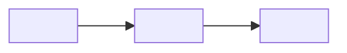

# AGEX Handoff Protocol

This document is the authoritative specification for how AGEX agents communicate: what the orchestrator sends to a specialist, what a specialist returns, how each result is interpreted, and when a run must stop and ask a human. It defines protocol version 1, used by AGEX 1.0.0.

The key words MUST, MUST NOT, SHOULD, and MAY are used as described in RFC 2119. For the system-level picture, see [Architecture](ARCHITECTURE.md). For the agents themselves, see [Agents](AGENTS.md).

## Contents

- [Overview](#overview)
- [The Delegation Packet](#the-delegation-packet)
- [The Artifact Envelope](#the-artifact-envelope)
- [Artifact Registry](#artifact-registry)
- [Artifact Templates](#artifact-templates)
- [Status Semantics and Orchestrator Actions](#status-semantics-and-orchestrator-actions)
- [ReviewVerdict Decision Rule](#reviewverdict-decision-rule)
- [Loop Semantics and Cycle Counting](#loop-semantics-and-cycle-counting)
- [Retry-Once Rule](#retry-once-rule)
- [Dispatch Budget](#dispatch-budget)
- [Escalation Block](#escalation-block)
- [Quality Gate](#quality-gate)
- [Illustrative Examples](#illustrative-examples)

## Overview

AGEX has four kinds of message:

| Message | Direction | Carried by |
|---|---|---|
| Delegation packet | Orchestrator to specialist | The prompt of an `Agent` tool call |
| Artifact | Specialist to orchestrator | The specialist's final message, returned as the `Agent` tool result |
| Escalation block | Orchestrator to user | The conversation, or the AgexReport when the orchestrator runs as a subagent |
| AgexReport | Orchestrator to user | The orchestrator's final message |

Five principles govern all of them:

1. **Hub routing.** Specialists never address each other. Every artifact returns to the orchestrator, which decides what is forwarded, to whom, and in how much detail.
2. **Self-contained messages.** A Claude Code subagent starts with only its system prompt and the prompt it is dispatched with; it cannot see the dispatching conversation. A delegation packet MUST therefore contain everything the specialist needs, and an artifact MUST make sense without the specialist's working transcript.
3. **Evidence over assertion.** Every statement about tests, builds, linters, or audits MUST come from a command that was actually run in that dispatch, and SHOULD cite the command. Statements about code SHOULD cite `path:line`.
4. **Artifacts live in the conversation.** Specialists return artifacts as messages; they do not write artifact files to the project. The only persistent record AGEX keeps is the event log in `.agex/session.log`.
5. **Secrets never travel.** No artifact may reproduce a secret value. Where a credential must be referenced, show at most its first 4 characters followed by `****`.

## The Delegation Packet

Every dispatch carries a delegation packet with six fields, in this order.

| Field | Required content | Rules |
|---|---|---|
| **Objective** | The outcome the specialist must achieve, in one sentence | State the result, not the method. One objective per dispatch. |
| **Inputs** | The artifacts, excerpts, and file paths the specialist needs | Quote artifact sections verbatim; the specialist cannot read them otherwise. Forward the relevant section, not whole transcripts. In a loop cycle, include the latest failing artifact section. |
| **Scope** | What is in scope and what is explicitly out of scope | Name files or directories. When coders run in parallel, list each coder's exclusive file set and name the files owned by others as out of scope. |
| **Constraints** | Rules the work must respect | Project conventions (from `CLAUDE.md` or observed style), forbidden actions, compatibility requirements, commands to run before reporting. |
| **Expected Artifact** | The artifact type to return | Exactly one type from the [Artifact Registry](#artifact-registry), with the instruction to return it as the final message starting with the marker line. |
| **Cycle** | Loop position | `<loop> <n>/3 for <unit>` (for example `coder-tester 2/3 for WU-1`), or `n/a` outside a loop. Append `(retry)` when the dispatch is a retry under the [Retry-Once Rule](#retry-once-rule). |

Recommended rendering:

```markdown
### AGEX Delegation
- **Objective:** <one sentence describing the outcome>
- **Inputs:** <what is attached below, and the file paths to read>
- **Scope:** In scope: <paths>. Out of scope: <paths or areas>.
- **Constraints:** <conventions, forbidden actions, required verification commands>
- **Expected Artifact:** <Type>. Return it as your final message, starting with the marker line.
- **Cycle:** <loop n/3 for unit, or n/a>

#### Attached Inputs
<verbatim artifact excerpts>
```

The field names and their order are normative; the surrounding heading is a convention. A worked packet appears in the [Illustrative Examples](#illustrative-examples).

## The Artifact Envelope

Every artifact starts with three lines:

```markdown
<!-- agex:artifact type=<Type> version=1 -->
## <Type>: <short title>
**Producer:** <agent> · **Status:** <enum> · **Confidence:** HIGH | MEDIUM | LOW
```

Rules:

1. **Marker line.** The first line of the artifact MUST be the marker, exactly as shown, with `<Type>` one of the twelve registered type names. The marker is an HTML comment, so it is invisible in rendered Markdown but trivially detectable with the pattern `^<!-- agex:artifact type=([A-Za-z]+) version=1 -->$`.
2. **Title line.** The second line MUST be a level-two heading whose type matches the marker, followed by a short title of a few words.
3. **Status line.** `Producer` is the bare agent name (`coder`, never `agex:coder`), even in plugin installs. The one variant is `<name> (inline fallback)`, written by a focused slash command that found no such agent in the session and did the specialist's work itself. `Status` MUST be exactly one value from the artifact's enum, in uppercase. `Confidence` MUST be exactly one of HIGH, MEDIUM, LOW; it is optional only for TestReport and CodeDiff, whose evidence is command output.
4. **Sections.** The body consists of the artifact's sections as `###` headings, with exactly the names and order given in [Artifact Templates](#artifact-templates). No section may be omitted: when a section has nothing to report, its content is `None`. Producers MUST NOT add other `###` sections; detail belongs inside the nearest section, where `####` subheadings are allowed. The one exception is an escalation block inside an AgexReport, described in [Escalation Block](#escalation-block).
5. **Placement.** A specialist's final message SHOULD consist of the artifact alone. The orchestrator locates the artifact by its marker and ignores anything before it.

Confidence semantics:

| Confidence | Meaning | How the orchestrator uses it |
|---|---|---|
| HIGH | Conclusions rest on directly observed evidence: code read, commands run, documentation quoted | Acts on the artifact as is |
| MEDIUM | Some conclusions are inferred from partial evidence, and the artifact says which | Acts on it, and gives inferred points extra scrutiny in review |
| LOW | Significant assumptions or gaps | Verifies the key claims (for example with a targeted researcher dispatch) or asks the user before building on them |

An artifact is **malformed**, and triggers the [Retry-Once Rule](#retry-once-rule), when any of these hold: the marker line is missing; the marker type or title type differs from the Expected Artifact; the status is not a value of the type's enum; a required section is missing or out of order; or a table required by the template is missing its header row.

**Versioning.** `version=1` is the only protocol version. A change to any type name, section heading, table header, or status enum is a breaking change and requires a new version number.

## Artifact Registry

| # | Type | Producer | Status values | Primary consumers |
|---|---|---|---|---|
| 1 | TaskPlan | planner | READY, NEEDS_INPUT | orchestrator (dispatch waves); researcher and architect (as context) |
| 2 | ResearchBrief | researcher | COMPLETE, PARTIAL, BLOCKED | architect, coder, debugger; orchestrator (when answering a question) |
| 3 | TechnicalRFC | architect | PROPOSED, NEEDS_INPUT | coder (work units), tester (test requirements), reviewer (acceptance criteria) |
| 4 | CodeDiff | coder | IMPLEMENTED, PARTIAL, BLOCKED | tester, reviewer |
| 5 | TestReport | tester | PASS, FAIL, ERROR | coder (failure traces), orchestrator (quality gate) |
| 6 | ReviewVerdict | reviewer | APPROVED, CHANGES_REQUESTED, BLOCKED | coder (issues), architect (on BLOCKED), orchestrator (quality gate) |
| 7 | DebugReport | debugger | FIXED, NOT_REPRODUCED, NEEDS_ESCALATION | tester (regression test), reviewer |
| 8 | SecurityAuditReport | security | PASS, FINDINGS, CRITICAL_FINDINGS | coder (fixes), reviewer, orchestrator (quality gate) |
| 9 | RefactorReport | refactor | COMPLETE, PARTIAL, ABORTED | reviewer |
| 10 | DocUpdate | documenter | COMPLETE, PARTIAL | orchestrator, user |
| 11 | DevOpsChange | devops | READY_FOR_CONFIRMATION, APPLIED_LOCALLY, BLOCKED | reviewer, user (confirmation) |
| 12 | AgexReport | orchestrator | DONE, PARTIAL, ESCALATED | user |

## Artifact Templates

Text in `<angle brackets>` is filled in by the producer. Everything else, including headings, table headers, and enum values, is literal.

### 1. TaskPlan

Produced by the planner. Orders the work, assigns an AGEX agent to every step, and groups steps into execution waves.

```markdown
<!-- agex:artifact type=TaskPlan version=1 -->
## TaskPlan: <short title>
**Producer:** planner · **Status:** READY | NEEDS_INPUT · **Confidence:** HIGH | MEDIUM | LOW

### Goal
<The end state in one or two sentences, phrased so that completion can be checked.>

### Assumptions
- <An assumption the plan depends on; if it proves false, the plan must be revisited.>

### Steps
| # | Step | Agent | Depends On | Parallel Group | Complexity (S/M/L) | Done When |
|---|---|---|---|---|---|---|
| 1 | <Concrete action> | <AGEX agent name> | - | A | S | <Verifiable completion condition> |
| 2 | <Concrete action> | <AGEX agent name> | 1 | B | M | <Verifiable completion condition> |

### Execution Waves
- Wave 1: steps 1 (sequential)
- Wave 2: steps 2, 3 (parallel)

### Risks & Mitigations
- <Risk> — <Mitigation>

### Open Questions
- <A question whose answer changes or unblocks the plan, or None>
```

- **Agent** is one of the twelve bare AGEX agent names.
- **Depends On** lists step numbers, or `-` when the step has no dependency.
- Steps in the same **Parallel Group** whose dependencies are satisfied can run concurrently.
- Status is NEEDS_INPUT when any Open Question blocks execution; otherwise READY.

### 2. ResearchBrief

Produced by the researcher. Every claim is anchored to code or documentation.

```markdown
<!-- agex:artifact type=ResearchBrief version=1 -->
## ResearchBrief: <short title>
**Producer:** researcher · **Status:** COMPLETE | PARTIAL | BLOCKED · **Confidence:** HIGH | MEDIUM | LOW

### Problem Summary
<What was investigated, what was found, and why it matters, in one short paragraph.>

### Affected Files
- `<path>:<line>` — <why it matters>

### External Documentation
- [<title>](<url>) — <key fact>

### Dependencies
- <Package, service, or module, with its version and how it is involved>

### Constraints & Risks
- <Constraint or risk, with its evidence>

### Open Questions
- <What could not be determined and what would resolve it, or None>
```

- The local codebase is searched first; the web is consulted for facts the code cannot answer.
- When no external documentation was needed, the External Documentation section is `None`.

### 3. TechnicalRFC

Produced by the architect. Decomposes the change into atomic, independently testable work units. It contains interfaces and types, never implementation bodies.

````markdown
<!-- agex:artifact type=TechnicalRFC version=1 -->
## TechnicalRFC: <short title>
**Producer:** architect · **Status:** PROPOSED | NEEDS_INPUT · **Confidence:** HIGH | MEDIUM | LOW

### Context & Goals
<Why the change is needed and the measurable goals it must meet.>

### Non-Goals
- <Something this design deliberately does not do>

### Component Architecture
<Components added or changed, their responsibilities, and where they attach to existing code (`path:line`).>

### Data Flow


### Interface & Type Definitions
```<language>
<Signatures, types, schemas, or API contracts. No implementation bodies.>
```

### Implementation Sequence
#### WU-1: <title>
- **Files:** <paths>
- **Change:** <what changes, precisely>
- **Depends On:** <work unit ids, or none>
- **Acceptance Criteria:** <verifiable checks>
- **Parallel-safe:** yes | no

#### WU-2: <title>
<The same five fields as WU-1.>

### Test Requirements
- <Test to add or run, mapped to the work unit and acceptance criterion it proves>

### Alternatives Considered & Risks
- <Alternative> — <why it was rejected>
- <Risk> — <mitigation>
````

- A work unit is **Parallel-safe: yes** only if it depends on no unfinished unit and shares no file with any unit that may run at the same time.
- Every acceptance criterion must be checkable by a command or by reading a specific location.
- Status is NEEDS_INPUT when a decision belongs to the user (a product choice, or a trade-off with no clear winner).

### 4. CodeDiff

Produced by the coder, one per work unit or fix. Confidence is optional.

```markdown
<!-- agex:artifact type=CodeDiff version=1 -->
## CodeDiff: <short title>
**Producer:** coder · **Status:** IMPLEMENTED | PARTIAL | BLOCKED · **Confidence:** HIGH | MEDIUM | LOW

### Summary
<What was implemented and how, in two to four sentences.>

### Work Units Implemented
- WU-<n>: <title> — <complete, or what remains>

### Files Changed
| File | Change (added/modified/deleted) | Notes |
|---|---|---|
| `<path>` | modified | <What changed and why> |

### Verification
- `<typecheck command>` — <exact result>
- `<lint command>` — <exact result>
- `<test command>` — <exact result>

### Deviations from RFC
- <Deviation and its justification, or None>

### Notes for Tester & Reviewer
- <Areas that need focused testing or scrutiny, and known limitations>
```

- The Change column holds one of `added`, `modified`, `deleted`.
- If the project has no type checker or linter, the Verification entry says so (for example `typecheck: not available, no tsconfig.json`) rather than being dropped.

### 5. TestReport

Produced by the tester. Confidence is optional. The Failure Traces section is written for the coder: it must be actionable without rerunning anything.

````markdown
<!-- agex:artifact type=TestReport version=1 -->
## TestReport: <short title>
**Producer:** tester · **Status:** PASS | FAIL | ERROR · **Confidence:** HIGH | MEDIUM | LOW

### Test Suites Executed
- `<exact command>`

### Pass/Fail Summary
| Suite | Passed | Failed | Skipped |
|---|---|---|---|
| <suite or file> | <n> | <n> | <n> |

### Tests Added or Updated
- `<path>` — <what it tests>

### Edge Cases Covered
- <Edge case, and the test that covers it>

### Failure Traces
#### F1: <test id>
- **Expected:** <expected value or behavior>
- **Actual:** <actual value or behavior>
- **Trace excerpt:**
  ```text
  <the relevant lines of the failure output>
  ```
- **Suspected location:** `<path>:<line>` — <why this location>

### Coverage
<Measured coverage and the command that measured it, or "not measured">

### Recommendation for Coder
- <A concrete next step for each failure, or None>
````

- FAIL means the tests ran and at least one failed. ERROR means the suite could not run or complete (build failure, missing runner, crashed process).
- When the status is PASS, Failure Traces is `None`.

### 6. ReviewVerdict

Produced by the reviewer. The status is derived mechanically from the issues; see [ReviewVerdict Decision Rule](#reviewverdict-decision-rule).

```markdown
<!-- agex:artifact type=ReviewVerdict version=1 -->
## ReviewVerdict: <short title>
**Producer:** reviewer · **Status:** APPROVED | CHANGES_REQUESTED | BLOCKED · **Confidence:** HIGH | MEDIUM | LOW

### Summary
<Overall assessment and the reason for the status, in two to four sentences.>

### Issues
| ID | Severity | Category | Location | Problem | Remediation |
|---|---|---|---|---|---|
| R1 | <CRITICAL, HIGH, MEDIUM, or LOW> | <category> | `<path>:<line>` | <What is wrong and why it matters> | <The specific change that fixes it> |

### Checks Performed
- [x] Logic and correctness
- [x] Security (OWASP Top 10)
- [x] Concurrency and race conditions
- [x] Error handling
- [x] Performance
- [x] Edge cases
- [x] Tests
- [x] Project conventions

### What Is Good
- <At most three specific strengths>
```

- **Category** is exactly one of `logic`, `security`, `performance`, `concurrency`, `error-handling`, `edge-case`, `style`, `tests`.
- A check that does not apply is left unticked with the reason, for example `- [ ] Concurrency and race conditions: not applicable, no shared state`.
- With no issues, the Issues section is `None` and the status is APPROVED.

### 7. DebugReport

Produced by the debugger, which reproduces and root-causes before it fixes.

````markdown
<!-- agex:artifact type=DebugReport version=1 -->
## DebugReport: <short title>
**Producer:** debugger · **Status:** FIXED | NOT_REPRODUCED | NEEDS_ESCALATION · **Confidence:** HIGH | MEDIUM | LOW

### Symptom
<The reported error or behavior, quoted exactly where possible.>

### Reproduction
- Command: `<exact command>`
- Observed output:
  ```text
  <relevant output>
  ```

### Isolation
<How the search space was narrowed: what was ruled out, and how.>

### Root Cause
`<path>:<line>` — <why this defect produces the symptom>

### Fix Applied
- `<path>` — <the minimal change made>

### Verification
- Before: `<command>` — <result>
- After: `<command>` — <result>

### Regression Risk
<What else the fix could affect, and how that was checked.>
````

- With status NOT_REPRODUCED or NEEDS_ESCALATION, Fix Applied is `None` and Verification records what was run.

### 8. SecurityAuditReport

Produced by the security agent. Secrets are never reproduced: evidence shows at most the first 4 characters followed by `****`.

```markdown
<!-- agex:artifact type=SecurityAuditReport version=1 -->
## SecurityAuditReport: <short title>
**Producer:** security · **Status:** PASS | FINDINGS | CRITICAL_FINDINGS · **Confidence:** HIGH | MEDIUM | LOW

### Scope
<What was audited (paths, dependency manifests, configuration) and what was excluded.>

### Risk Matrix
| ID | Severity | Category | Location | Finding | Evidence (redacted) | Remediation |
|---|---|---|---|---|---|---|
| S1 | <CRITICAL, HIGH, MEDIUM, or LOW> | <OWASP id such as A03:2021-Injection, or a CWE id> | `<path>:<line>` | <What is vulnerable> | <Redacted excerpt> | <The specific fix> |

### Secrets Scan
<Method and result. Any secret appears as its first 4 characters followed by ****.>

### Dependency Audit
<Audit commands run and their results, or why no audit could run.>

### Configuration Review
<Findings on permissions, CORS, security headers, debug flags, and similar settings.>

### Summary
- CRITICAL: <n> · HIGH: <n> · MEDIUM: <n> · LOW: <n>
- Overall risk: <CRITICAL, HIGH, MEDIUM, or LOW>
```

- **Category** uses OWASP Top 10 2021 identifiers (for example `A02:2021-Cryptographic Failures`, `A03:2021-Injection`, `A05:2021-Security Misconfiguration`) or CWE identifiers (for example `CWE-798`).
- Status is PASS when the Risk Matrix is empty, CRITICAL_FINDINGS when any finding is CRITICAL, and FINDINGS otherwise.

### 9. RefactorReport

Produced by the refactor agent. A refactoring changes structure, never behavior.

```markdown
<!-- agex:artifact type=RefactorReport version=1 -->
## RefactorReport: <short title>
**Producer:** refactor · **Status:** COMPLETE | PARTIAL | ABORTED · **Confidence:** HIGH | MEDIUM | LOW

### Smells Identified
- `<path>:<line>` — <the smell, for example duplicated validation logic>

### Refactorings Applied
1. **<Pattern name, for example Extract Function>** — Files: `<paths>` — Rationale: <why>

### Test Baseline
- `<command>` — <result before any change>

### Test Result After
- `<command>` — <result after the final step>

### Behavior Change
None

### Follow-ups
- <Refactorings deliberately left for later, or None>
```

- Behavior Change MUST be `None` for a COMPLETE report. Any other content explains the change, and the status is then PARTIAL or ABORTED.
- The Test Baseline and Test Result After commands SHOULD be identical so the results are comparable.

### 10. DocUpdate

Produced by the documenter.

```markdown
<!-- agex:artifact type=DocUpdate version=1 -->
## DocUpdate: <short title>
**Producer:** documenter · **Status:** COMPLETE | PARTIAL · **Confidence:** HIGH | MEDIUM | LOW

### Files Created or Updated
- `<path>` — <created or updated>

### Summary of Changes
<What was documented, and for which audience.>

### Examples Added
- `<path>` — <what the example demonstrates>

### Preserved Content
<Existing content intentionally kept, and confirmation that nothing was removed unless the task asked for it.>

### Follow-ups
- <Documentation gaps outside this task's scope, or None>
```

### 11. DevOpsChange

Produced by the devops agent. Remote and irreversible operations are listed, never executed without explicit human confirmation.

```markdown
<!-- agex:artifact type=DevOpsChange version=1 -->
## DevOpsChange: <short title>
**Producer:** devops · **Status:** READY_FOR_CONFIRMATION | APPLIED_LOCALLY | BLOCKED · **Confidence:** HIGH | MEDIUM | LOW

### Summary
<What changed in the pipeline, container, or infrastructure configuration, and why.>

### Files Changed
- `<path>` — <added, modified, or deleted>: <what changed>

### Local Verification
- `<command>` — <exact result>

### Human Confirmation Required
1. <Remote or irreversible action that was NOT executed> — `<exact command>`

### Rollback Plan
<Step-by-step commands that undo each change, local and remote.>

### Secrets & Environment Requirements
- <Variable or secret name and where it must be configured; values are never included>
```

- APPLIED_LOCALLY means every change is local and verified, and Human Confirmation Required is `None`.
- READY_FOR_CONFIRMATION means local changes are verified and at least one remote or irreversible action is waiting for the user.

### 12. AgexReport

Produced by the orchestrator as the final synthesis of a run.

```markdown
<!-- agex:artifact type=AgexReport version=1 -->
## AgexReport: <short title>
**Producer:** orchestrator · **Status:** DONE | PARTIAL | ESCALATED · **Confidence:** HIGH | MEDIUM | LOW

### Task
<The request, restated, and the complexity tier assigned (SIMPLE, MEDIUM, or COMPLEX).>

### Outcome
<What was achieved, in two to four sentences.>

### Agents Deployed
| # | Agent | Artifact | Status | Cycle |
|---|---|---|---|---|
| <n> | <agent> | <artifact type> | <status> | <loop n/3 for unit, or n/a> |

### Changes
- `<path>` — <summary of the change>

### Verification Evidence
- <Latest TestReport status and command, latest ReviewVerdict status, security status, acceptance criteria checked>

### Open Issues & Escalations
- <Open item, an escalation block, or None>

### Next Steps
- <Recommended follow-up actions for the user>
```

- Agents Deployed has one row per dispatch, in dispatch order, including retries.
- Verification Evidence repeats commands and results from specialist artifacts; the orchestrator never introduces results it did not receive.

## Status Semantics and Orchestrator Actions

A valid artifact's status determines the orchestrator's next move. Unfavorable statuses such as FAIL or BLOCKED are valid results handled here; they are not failures under the [Retry-Once Rule](#retry-once-rule).

**TaskPlan**

| Status | Meaning | Orchestrator action |
|---|---|---|
| READY | The plan can be executed as written | Execute the waves in order, dispatching each wave's parallel steps in a single turn |
| NEEDS_INPUT | Open Questions block execution | Present the Open Questions to the user and wait; dispatch nothing that depends on the answers |

**ResearchBrief**

| Status | Meaning | Orchestrator action |
|---|---|---|
| COMPLETE | Every question in scope is answered with evidence | Continue to the next step, or answer the user directly for investigation tasks |
| PARTIAL | Some questions remain open; what is reported is evidenced | Continue if the gaps do not affect the design; otherwise dispatch one narrowly scoped follow-up or ask the user |
| BLOCKED | Investigation could not proceed (missing access, missing input, contradictory requirements) | Supply what is missing and re-dispatch once, or escalate |

**TechnicalRFC**

| Status | Meaning | Orchestrator action |
|---|---|---|
| PROPOSED | The design is complete and work units are defined | Dispatch work units in Implementation Sequence order; parallel-safe units with disjoint files go out in the same turn |
| NEEDS_INPUT | A design decision belongs to the user | Ask the user; start no implementation until it is answered |

**CodeDiff**

| Status | Meaning | Orchestrator action |
|---|---|---|
| IMPLEMENTED | The unit is implemented and the coder's verification commands ran | Dispatch the tester |
| PARTIAL | Part of the unit is implemented; the remainder is stated | Test the implemented part if it is independently testable; re-dispatch the remainder or escalate |
| BLOCKED | The unit cannot be implemented as specified | If the RFC is infeasible, route to the architect (this uses the unit's single redesign); otherwise escalate |

**TestReport**

| Status | Meaning | Orchestrator action |
|---|---|---|
| PASS | Every executed test passed | Dispatch the reviewer, or re-review if this run followed a review-driven fix |
| FAIL | Tests ran and at least one failed | Attribute each failure to a work unit, then start the next coder-tester cycle for each affected unit with its Failure Traces, unless its breaker or the no-progress rule trips |
| ERROR | The suite could not run or complete | If the cause is in the changed code (for example a compile or type error in a changed file), handle it as FAIL; if it is environmental (missing runner, unavailable service), spend no cycle and resolve it with the user or escalate |

**ReviewVerdict**

| Status | Meaning | Orchestrator action |
|---|---|---|
| APPROVED | No CRITICAL, HIGH, or MEDIUM issues | Proceed to the documenter if needed, then the quality gate; list LOW issues as non-blocking in the AgexReport |
| CHANGES_REQUESTED | At least one HIGH or MEDIUM issue and no CRITICAL | Start the next coder-reviewer cycle with the Issues table; re-test the fix, then re-review |
| BLOCKED | At least one CRITICAL issue | Stop the loop immediately. Route the unit once to the architect for redesign, or escalate. A second BLOCKED for the same unit always escalates. |

**DebugReport**

| Status | Meaning | Orchestrator action |
|---|---|---|
| FIXED | Reproduced, root-caused, fixed, and verified | Dispatch the tester for a regression test, then the reviewer |
| NOT_REPRODUCED | The symptom could not be reproduced; no fix applied | Report what was tried and ask the user for environment details, inputs, or logs |
| NEEDS_ESCALATION | The root cause is out of scope or too risky to fix in place, or could not be isolated | Escalate, or route to the architect when the root cause is a design flaw |

**SecurityAuditReport**

| Status | Meaning | Orchestrator action |
|---|---|---|
| PASS | The Risk Matrix is empty | Record it in Verification Evidence and continue |
| FINDINGS | At least one finding, none CRITICAL | Report the findings. Open HIGH findings block the quality gate: if the user asked for fixes, route them to the coder, then the reviewer, then a security re-check; otherwise list them under Open Issues |
| CRITICAL_FINDINGS | At least one CRITICAL finding | The quality gate is blocked. Surface the findings to the user immediately; route fixes to the coder only when fixes were requested, followed by the reviewer and a security re-check |

**RefactorReport**

| Status | Meaning | Orchestrator action |
|---|---|---|
| COMPLETE | All planned refactorings applied, tests identical before and after, Behavior Change `None` | Dispatch the reviewer |
| PARTIAL | Some refactorings applied safely; others were not | Dispatch the reviewer for the applied steps and report the rest as follow-ups |
| ABORTED | The refactor stopped (baseline not green, or behavior could not be preserved) | Report the reason and the stated state of the working tree to the user; do not continue refactoring |

**DocUpdate**

| Status | Meaning | Orchestrator action |
|---|---|---|
| COMPLETE | All requested documentation is written | Include it in the AgexReport |
| PARTIAL | Some documentation could not be completed, for example because behavior could not be confirmed from the code | Report the follow-ups; optionally dispatch the researcher to establish the missing facts |

**DevOpsChange**

| Status | Meaning | Orchestrator action |
|---|---|---|
| READY_FOR_CONFIRMATION | Local changes verified; remote or irreversible actions listed but not executed | Dispatch the reviewer, then present the Human Confirmation Required list to the user verbatim. An action may be executed only after the user explicitly confirms that numbered item, by re-dispatching devops with the confirmation quoted in its Inputs |
| APPLIED_LOCALLY | All changes are local and verified | Dispatch the reviewer |
| BLOCKED | The change cannot proceed (missing credentials, a local build failure outside scope) | Escalate with the stated requirement |

**AgexReport**

| Status | Meaning for the user |
|---|---|
| DONE | The quality gate passed |
| PARTIAL | Some work is complete and verified, and some is not; the report says exactly which |
| ESCALATED | A circuit breaker tripped or a decision is needed; Open Issues & Escalations contains at least one escalation block |

## ReviewVerdict Decision Rule

The reviewer does not choose a status by feel. It is derived from the issue severities:

```text
if any issue has severity CRITICAL:
    status = BLOCKED
else if any issue has severity HIGH or MEDIUM:
    status = CHANGES_REQUESTED
else:
    status = APPROVED        (LOW issues are listed as non-blocking)
```

Severity guidance:

| Severity | Typical examples |
|---|---|
| CRITICAL | Exploitable security vulnerability, data loss or corruption, crash or outage on a main path, a design that cannot meet the requirement |
| HIGH | Incorrect behavior in a realistic scenario, a security weakness that needs specific conditions to exploit, missing error handling that can crash or leak data |
| MEDIUM | A bug in an edge case, a performance problem under realistic load, new logic without tests, a maintainability problem likely to cause defects |
| LOW | Style, naming, minor readability; never blocks |

Every issue MUST name a precise location and a specific remediation. "Consider improving error handling" is not a remediation; "wrap the `JSON.parse` call at `src/api/client.ts:48` and return a 400 with the shared error envelope" is.

## Loop Semantics and Cycle Counting

AGEX runs two loops per work unit: coder ⇄ tester and coder ⇄ reviewer. Both have a limit of **3 cycles**.

**Definitions**

- **Work unit.** A `WU-n` from the TechnicalRFC. When a MEDIUM task has no RFC, the whole change is treated as `WU-1`.
- **Loop entry.** A loop is entered when the first TestReport for a unit (after its initial CodeDiff) is FAIL, or the first ReviewVerdict is CHANGES_REQUESTED. The initial implementation and its first test run or first review are not cycles.
- **Cycle.** In the coder-tester loop, one coder fix plus one tester re-run. In the coder-reviewer loop, one coder fix plus one re-review.
- **Counter.** Each (loop, work unit) pair has its own counter, which runs from 1 to 3. The orchestrator logs `CYCLE loop=coder-tester n=<n>/3` when a cycle starts.
- **Breaker.** The coder-tester breaker trips when the re-run that closes cycle 3 is still FAIL, which is the third failing TestReport inside the loop. The coder-reviewer breaker trips when the re-review that closes cycle 3 is not APPROVED. Either way, the orchestrator stops work on that unit and escalates.

A unit that keeps failing its tests:

| Event | coder-tester counter (WU-1) | TestReport |
|---|---|---|
| Initial CodeDiff, first test run | not in loop | FAIL, loop entered |
| Cycle 1: coder fix, tester re-run | 1/3 | FAIL (signature A) |
| Cycle 2: coder fix, tester re-run | 2/3 | FAIL (signature B) |
| Cycle 3: coder fix, tester re-run | 3/3 | FAIL: breaker trips, escalate |

**No-progress rule.** If the artifacts that close two consecutive cycles fail with the same failure signature, the orchestrator escalates early without spending the remaining cycles. In the table above, if cycle 2 had also failed with signature A, the loop would stop after cycle 2.

- For a TestReport, the failure signature is the set of failing test ids together with, for each, the error type or assertion and the suspected location.
- For a ReviewVerdict, it is the set of blocking issues (CRITICAL, HIGH, MEDIUM) identified by category, location, and problem. A reviewer re-raising the same issues means the fixes are not landing.

**Rules that connect the loops**

- **Independence.** Counters are independent per loop and per work unit. Three test cycles on WU-1 consume nothing from WU-2, or from WU-1's review loop.
- **Attribution.** When one TestReport covers several units, the orchestrator attributes each failure to a unit through its suspected location and the units' file lists. Only units with attributed failures start a cycle, and units with disjoint files can be fixed in parallel.
- **Re-test before re-review.** A review-driven fix changes code, so the tester re-runs before the reviewer looks again. A FAIL at that point is handled by the coder-tester loop and increments that counter; the coder-reviewer counter increments only when a re-review happens.
- **BLOCKED ends the review loop at once,** whatever the counter says. The orchestrator either escalates or routes the unit to the architect with the CRITICAL issues and the current RFC. A redesigned unit is re-implemented with fresh counters, but each unit may be redesigned only once: a second BLOCKED escalates.
- **Retries are not cycles.** A retry under the Retry-Once Rule does not change any loop counter.

## Retry-Once Rule

A dispatch has **failed** when the `Agent` call returns an error, returns an empty result, or returns an artifact that is malformed (see [The Artifact Envelope](#the-artifact-envelope)) or of the wrong type.

1. The orchestrator re-dispatches the same agent **once**, with simplified and narrower instructions: a smaller scope, the full template of the Expected Artifact restated, optional inputs removed, and a one-line statement of what was wrong with the previous attempt. The Cycle field is marked `(retry)`.
2. If the retry also fails, the orchestrator escalates with an escalation block titled `ESCALATION: <agent> circuit breaker tripped`.

Retries count toward the [Dispatch Budget](#dispatch-budget) but not toward any loop counter. A valid artifact with an unfavorable status is never a failure under this rule.

## Dispatch Budget

A run has a soft cap of **15 sub-agent dispatches**. Every `Agent` call counts as one dispatch, including retries and each member of a parallel batch. Before making a dispatch that would exceed the cap, the orchestrator stops, summarizes progress and the remaining work, estimates the additional dispatches needed, and asks the user whether to continue.

## Escalation Block

When a breaker trips, a retry fails, or a decision belongs to the user, the orchestrator emits:

```text
### ESCALATION: <loop or agent> circuit breaker tripped
- What was attempted: <cycles, agents>
- Evidence: <latest artifact excerpt>
- Options: 1) ... 2) ... 3) ...
- Recommended: <option>
```

- **What was attempted** names the loop or agent, the unit, and the cycles used, for example `coder-tester loop on WU-1, 3/3 cycles, coder and tester`.
- **Evidence** quotes the decisive excerpt of the latest artifact (a failure trace, an issue row) rather than paraphrasing it.
- **Options** are concrete and distinct, for example granting further cycles, revising the design, narrowing scope, or taking over manually.
- **Recommended** names one of the options and says why in a clause.
- When the main conversation is the orchestrator (`/agex`), the block is shown immediately and the orchestrator waits for the user's choice. When the orchestrator runs as a subagent, the block is placed inside the AgexReport's Open Issues & Escalations section, where it is the only `###` heading allowed inside another section, and the report status is ESCALATED.

Filled example:

```text
### ESCALATION: coder-tester circuit breaker tripped
- What was attempted: coder-tester loop on WU-3 (CSV export), 2/3 cycles; stopped early by the no-progress rule
- Evidence: cycles 1 and 2 both failed `export › escapes embedded quotes` with "Expected: "a""b" Received: "a"b"" at src/export/csv.ts:57
- Options: 1) Allow one more cycle with the RFC's quoting rule restated as a failing example 2) Route WU-3 to the architect to adopt a CSV library instead of hand-written escaping 3) Ship without CSV export and track it as a follow-up
- Recommended: 2) the same defect survived two fixes, which points at the approach rather than the code
```

## Quality Gate

Before reporting DONE, the orchestrator confirms all of the following:

- [ ] The latest TestReport is PASS, and the latest ReviewVerdict is APPROVED. Either is not applicable only when the routed chain omits that agent (a SIMPLE single-specialist run, or a plan-only, research-only, or documentation chain), with the reason stated in Verification Evidence.
- [ ] No CRITICAL or HIGH security findings are open.
- [ ] Every acceptance criterion from the TechnicalRFC or TaskPlan has been checked.

"Latest" means produced after the most recent CodeDiff for every unit. If a condition fails and loop budget remains, the orchestrator runs the appropriate loop. If no budget remains, the report is PARTIAL or ESCALATED, never DONE.

## Illustrative Examples

> **Illustrative example.** The project, file paths, line numbers, command output, and numbers below are fictional. They exist only to show correctly filled artifacts, and they follow one coherent scenario.

**Scenario.** A TypeScript Express API (`orders-api`) runs as one container behind an nginx reverse proxy and uses Jest with supertest. The user runs `/agex add rate limiting to the login endpoint and the rest of the API`. The orchestrator classifies the task as COMPLEX. After the planner's TaskPlan, the researcher returns Example 1. The architect's TechnicalRFC defines two parallel-safe work units: **WU-1** builds the limiter module (`src/middleware/rateLimit.ts`, `src/config/env.ts`), and **WU-2** wires it into the app (`src/app.ts`, `src/routes/auth.ts`). Two coders implement them in parallel, the first test run produces Example 2, one cycle fixes both failures, and the first review produces Example 3.

### Example 1: ResearchBrief (COMPLETE)

```markdown
<!-- agex:artifact type=ResearchBrief version=1 -->
## ResearchBrief: Rate limiting for the orders API
**Producer:** researcher · **Status:** COMPLETE · **Confidence:** HIGH

### Problem Summary
The API has no request throttling. `POST /api/auth/login` accepts unlimited password attempts from a client, which permits brute force and credential stuffing, and every `/api` route can be called at an unbounded rate. The app runs behind one nginx reverse proxy and Express does not trust it, so `req.ip` is the proxy's address for every request: a per-client limit keyed on `req.ip` would put all users into a single bucket unless Express is configured to trust exactly one proxy hop.

### Affected Files
- `src/app.ts:8` — `const app = express();` with no `trust proxy` setting, so `req.ip` is the proxy address in production.
- `src/app.ts:14` — `app.use(express.json())`, the start of the middleware chain where a limiter would be mounted.
- `src/app.ts:19` — `app.get('/healthz', ...)`, polled by the container health check (`deploy/docker-compose.yml:14`); a 429 here would mark a healthy container unhealthy, so it must never be limited.
- `src/app.ts:22` — `app.use('/api/auth', authRouter)`, where the auth routes are mounted.
- `src/routes/auth.ts:18` — `router.post('/login', ...)` with no attempt limiting; failed logins return 401 through `next(new HttpError(401, ...))` at line 31.
- `src/middleware/errorHandler.ts:12` — every error is serialized as `{ "error": { "code", "message" } }`; a 429 response should use the same envelope.
- `src/config/env.ts:6` — the zod schema that validates every environment variable at startup; new settings belong in it.
- `tests/helpers/createTestApp.ts:5` — tests build the app through `createApp()` (`src/app.ts:30`), so limits must be injectable to keep the suite from throttling itself.
- `deploy/nginx.conf:38` — `proxy_set_header X-Forwarded-For $proxy_add_x_forwarded_for;` confirms a single proxy hop in front of the app.

### External Documentation
- [RFC 6585, section 4](https://www.rfc-editor.org/rfc/rfc6585#section-4) — defines 429 Too Many Requests; the response may include a Retry-After header.
- [Express behind proxies](https://expressjs.com/en/guide/behind-proxies.html) — a numeric `trust proxy` value trusts that many hops; `true` takes the left-most `X-Forwarded-For` entry, which the client controls.
- [express-rate-limit](https://github.com/express-rate-limit/express-rate-limit) — Express middleware with `windowMs`, `limit`, `standardHeaders`, `skipSuccessfulRequests`, `skip`, and `handler` options; its default store is in memory and per process.

### Dependencies
- `express` 4.x (`package.json:18`) is the host framework.
- No rate-limiting package is installed; `express-rate-limit` would be the only new runtime dependency.
- `jest` and `supertest` (`package.json:34-35`) are the test stack; supertest can set `X-Forwarded-For` to simulate distinct clients.

### Constraints & Risks
- The in-memory store is per process. `deploy/docker-compose.yml:9` runs a single `api` container today; running more replicas later would require a shared store such as Redis.
- Setting `trust proxy` to `true` would let clients spoof `X-Forwarded-For` and bypass per-client limits. The correct value for this deployment is `1`.
- Counting successful logins toward the login limit would lock out legitimate users who sign in repeatedly; only failed attempts should count.
- The existing suite logs in many times per run, so limits must be passed in through `createApp()`.

### Open Questions
- No limits have been specified. Proposed configurable defaults: 5 failed login attempts per 15 minutes per client, and 100 requests per minute per client for other `/api` routes. Design can proceed with these defaults.
```

**What the orchestrator does next.** The status is COMPLETE and the one open question comes with usable defaults, so it dispatches the architect with this brief and records the proposed limits under Next Steps in the final report for the user to confirm.

### Example 2: TestReport (FAIL)

````markdown
<!-- agex:artifact type=TestReport version=1 -->
## TestReport: Rate limiting, first run for WU-1 and WU-2
**Producer:** tester · **Status:** FAIL

### Test Suites Executed
- `npx jest tests/middleware/rateLimit.test.ts`
- `npm test`

### Pass/Fail Summary
| Suite | Passed | Failed | Skipped |
|---|---|---|---|
| tests/middleware/rateLimit.test.ts | 5 | 2 | 0 |
| Full suite (`npm test`, 14 files) | 61 | 2 | 1 |

### Tests Added or Updated
- `tests/middleware/rateLimit.test.ts` — new; 7 tests covering the login limiter, the general API limiter, `Retry-After`, client separation, and the health check exemption.
- `tests/helpers/createTestApp.ts` — passes small test limits into `createApp()` (login 3, API 5, window 1000 ms).

### Edge Cases Covered
- Boundary: the 3rd failed login in a window returns 401 and the 4th returns 429.
- Window reset: after waiting past the 1-second test window, a blocked client is allowed again.
- Client separation: two clients with different `X-Forwarded-For` addresses keep independent budgets.
- Blocked responses carry a `Retry-After` header.
- Health check exemption: `/healthz` keeps returning 200 after a client's API budget is exhausted.

### Failure Traces
#### F1: rate limiting › login › returns 429 with the standard error envelope after 3 failed attempts
- **Expected:** status 429 with body `{"error":{"code":"RATE_LIMITED","message":"Too many login attempts. Try again later."}}`
- **Actual:** status 429 with a `text/html` body `Too many requests, please try again later.`, so `res.body` is `{}`
- **Trace excerpt:**
  ```text
  ● rate limiting › login › returns 429 with the standard error envelope after 3 failed attempts

    expect(received).toEqual(expected) // deep equality

    - Expected  - 6
    + Received  + 1

    - {
    -   "error": {
    -     "code": "RATE_LIMITED",
    -     "message": "Too many login attempts. Try again later.",
    -   },
    - }
    + {}

      at Object.<anonymous> (tests/middleware/rateLimit.test.ts:42:22)
  ```
- **Suspected location:** `src/middleware/rateLimit.ts:17` — the login limiter is created without a `handler`, so the library's default plain-text message is sent instead of the shared error envelope.

#### F2: rate limiting › health check › /healthz is not throttled when the client budget is exhausted
- **Expected:** status 200
- **Actual:** status 429
- **Trace excerpt:**
  ```text
  ● rate limiting › health check › /healthz is not throttled when the client budget is exhausted

    expect(received).toBe(expected) // Object.is equality

    Expected: 200
    Received: 429

      at Object.<anonymous> (tests/middleware/rateLimit.test.ts:88:24)
  ```
- **Suspected location:** `src/app.ts:16` — `app.use(apiLimiter)` is registered for every route, ahead of `/healthz` at line 21; the TechnicalRFC mounts it on `/api` only.

### Coverage
not measured (`jest.config.ts` does not enable coverage collection)

### Recommendation for Coder
- F1 (WU-1): give the login limiter a `handler` that responds with status 429 and `{ error: { code: 'RATE_LIMITED', message: 'Too many login attempts. Try again later.' } }`, matching `src/middleware/errorHandler.ts:12`.
- F2 (WU-2): mount the general limiter with `app.use('/api', apiLimiter)` as the RFC specifies, which leaves `/healthz` outside it.
````

**What the orchestrator does next.** This is the first test run, so the coder-tester loop is entered. F1 is attributed to WU-1 and F2 to WU-2; their files are disjoint, so the orchestrator starts cycle 1 for both units in one turn, logging `CYCLE loop=coder-tester n=1/3` for each. The packet for WU-1:

```markdown
### AGEX Delegation
- **Objective:** Make the login limiter answer with the project's standard 429 error envelope so that test F1 passes.
- **Inputs:** TechnicalRFC WU-1 and TestReport failure F1, attached below. Read `src/middleware/rateLimit.ts` and `src/middleware/errorHandler.ts`.
- **Scope:** In scope: `src/middleware/rateLimit.ts`. Out of scope: `src/app.ts` and `src/routes/auth.ts` (owned by the coder fixing WU-2 in parallel), and all test files.
- **Constraints:** Reuse the error envelope from `src/middleware/errorHandler.ts:12`. No new dependencies. Run `npm run typecheck`, `npm run lint`, and `npx jest tests/middleware/rateLimit.test.ts` before reporting, and report their exact results.
- **Expected Artifact:** CodeDiff. Return it as your final message, starting with the marker line.
- **Cycle:** coder-tester 1/3 for WU-1

#### Attached Inputs
WU-1 acceptance criterion: when the login limit is exceeded, the response is status 429 with body `{ "error": { "code": "RATE_LIMITED", "message": "Too many login attempts. Try again later." } }` and a `Retry-After` header.

F1: expected that body with status 429; actual status 429 with the text/html body "Too many requests, please try again later."; suspected location `src/middleware/rateLimit.ts:17`, where the limiter is created without a `handler`.
```

Both fixes land and the re-run closing cycle 1 is PASS, so the orchestrator dispatches the reviewer.

### Example 3: ReviewVerdict (CHANGES_REQUESTED)

```markdown
<!-- agex:artifact type=ReviewVerdict version=1 -->
## ReviewVerdict: Rate limiting for auth and API routes
**Producer:** reviewer · **Status:** CHANGES_REQUESTED · **Confidence:** HIGH

### Summary
After the first test cycle the limiters are scoped correctly: `/healthz` is exempt, 429 responses use the shared error envelope, and the new tests pass. Two defects would make the feature ineffective or harmful in production: `trust proxy` is set to `true`, which lets any client choose its own rate-limit key, and the login limiter counts successful logins, so legitimate users can lock themselves out. One setting also bypasses the project's environment validation. There is no CRITICAL issue; one HIGH and two MEDIUM issues require changes.

### Issues
| ID | Severity | Category | Location | Problem | Remediation |
|---|---|---|---|---|---|
| R1 | HIGH | security | `src/app.ts:9` | `app.set('trust proxy', true)` makes `req.ip` the left-most `X-Forwarded-For` entry, which the client controls. An attacker can send a different address with every request and never reach the login limit, which defeats the brute-force protection. | Use `app.set('trust proxy', 1)` to trust exactly the one nginx hop configured in `deploy/nginx.conf:38`. Add a regression test (tester) proving that a spoofed left-most `X-Forwarded-For` entry does not reset a client's budget. |
| R2 | MEDIUM | logic | `src/middleware/rateLimit.ts:14` | The login limiter counts every request, including successful logins. A user who signs in 5 times within 15 minutes, for example from several devices, is locked out although no attempt failed. This contradicts the requirement that only failed attempts count. | Pass `skipSuccessfulRequests: true` to the login limiter so that only responses with status 400 or above count, and add a test (tester) showing that 6 successful logins in one window are all allowed. |
| R3 | MEDIUM | error-handling | `src/config/env.ts:21` | `RATE_LIMIT_API_MAX` is read with `Number(process.env.RATE_LIMIT_API_MAX ?? 100)` outside the zod schema that validates every other variable, so a typo such as `RATE_LIMIT_API_MAX=10O` yields `NaN` at startup with no error. | Declare it in the schema as `z.coerce.number().int().positive().default(100)`, like the neighboring settings. |
| R4 | LOW | style | `src/middleware/rateLimit.ts:9` | The window is written inline as `15 * 60 * 1000` in two places. | Extract a named constant such as `LOGIN_WINDOW_MS`. Non-blocking. |

### Checks Performed
- [x] Logic and correctness: limiter options, window arithmetic, middleware order in `src/app.ts`
- [x] Security (OWASP Top 10): client IP derivation and header trust (A07:2021-Identification and Authentication Failures), error message content
- [x] Concurrency and race conditions: the in-memory store is per process, which is acceptable for the single-container deployment and is recorded as a non-goal in the TechnicalRFC
- [x] Error handling: the 429 envelope matches `src/middleware/errorHandler.ts:12`; startup validation of new settings
- [x] Performance: the limiter adds one in-memory counter update per request and no blocking calls
- [x] Edge cases: window boundary, window reset, health check exemption, successful logins
- [x] Tests: `tests/middleware/rateLimit.test.ts` checked against the RFC's test requirements; the latest TestReport is PASS
- [x] Project conventions: naming, module layout, and configuration access match the existing middleware; inspected with `git diff --stat` and `git diff -- src tests`

### What Is Good
- Limits are injected through `createApp()`, which keeps the existing suite fast and unthrottled.
- The 429 response reuses the project's error envelope instead of inventing a new format.
- Limiter construction lives in one module with typed options, so moving to a shared store later is a one-file change.
```

**What the orchestrator does next.** There is no CRITICAL issue and there are HIGH and MEDIUM issues, so the decision rule yields CHANGES_REQUESTED. R1 belongs to WU-2 (`src/app.ts`); R2, R3, and R4 belong to WU-1. The orchestrator starts coder-reviewer cycle 1 for both units in parallel, forwarding each unit's rows of the Issues table (R4 marked optional). It then dispatches the tester to add the two regression tests the remediations call for and re-run the suites, and dispatches the reviewer again only after that TestReport is PASS.
